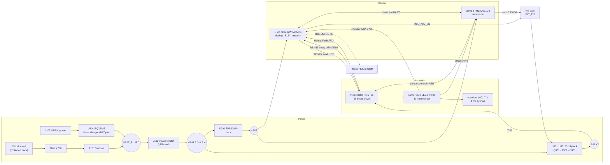
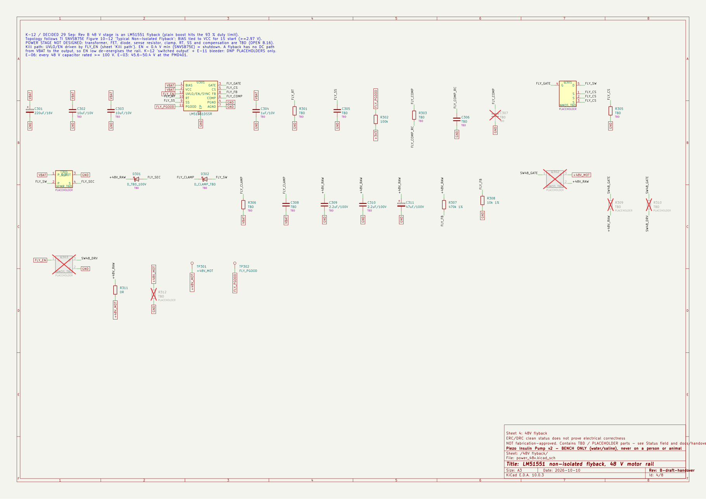
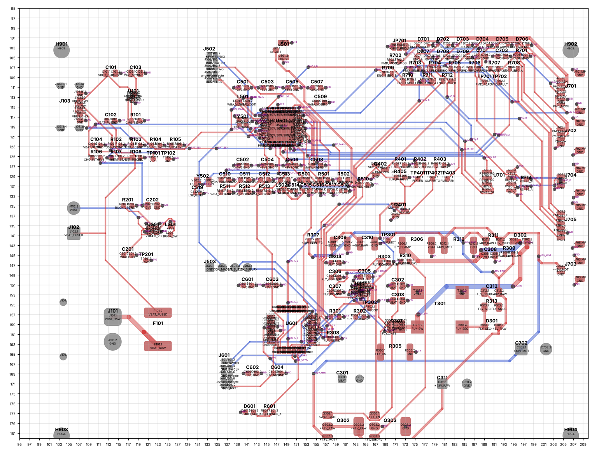
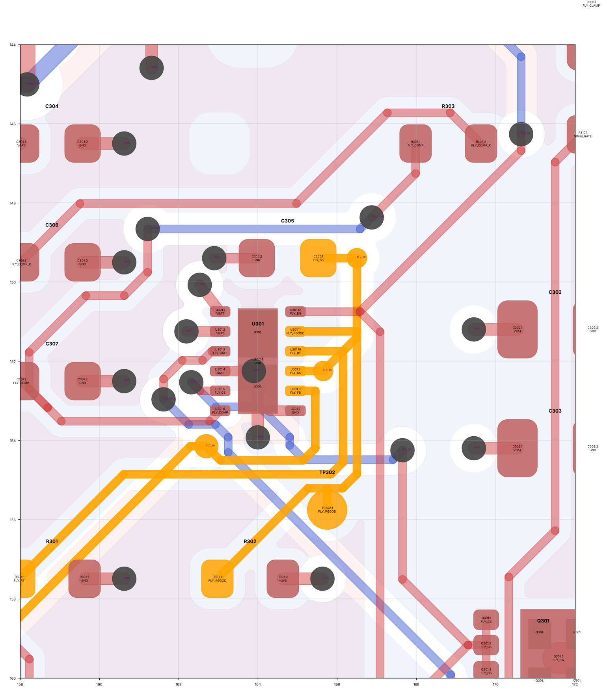
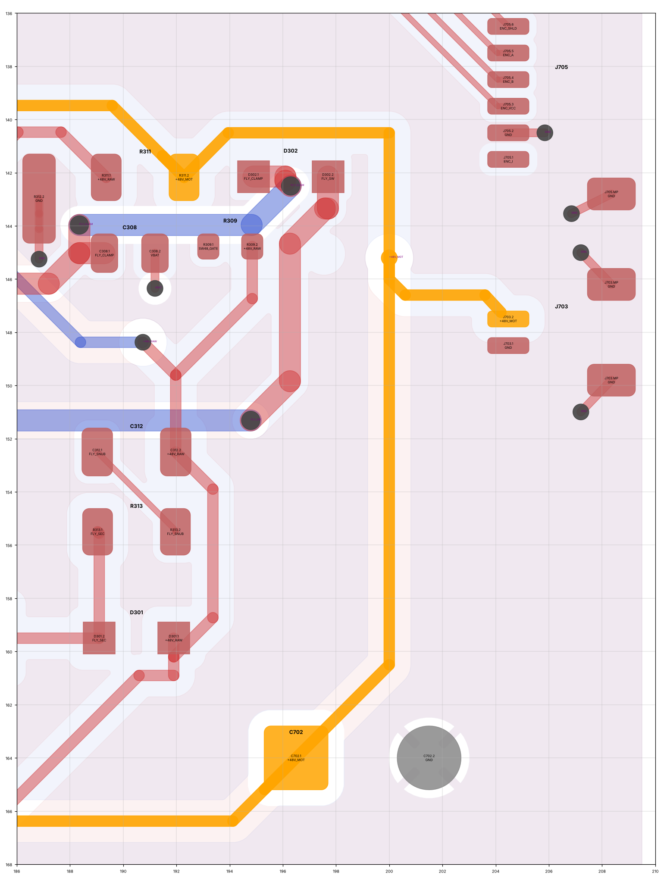
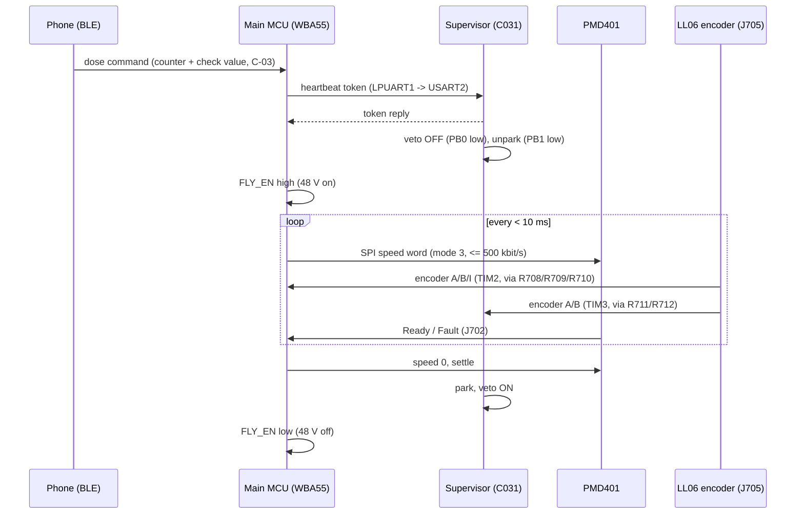
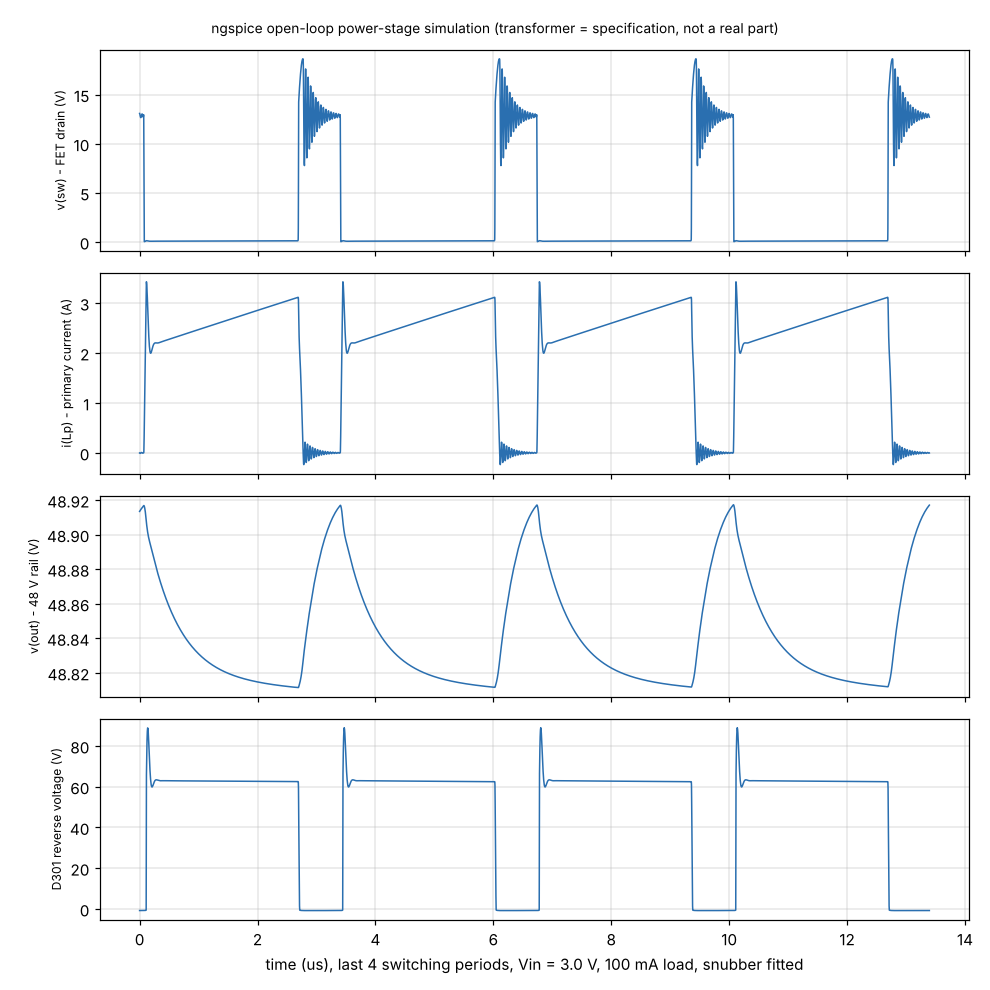
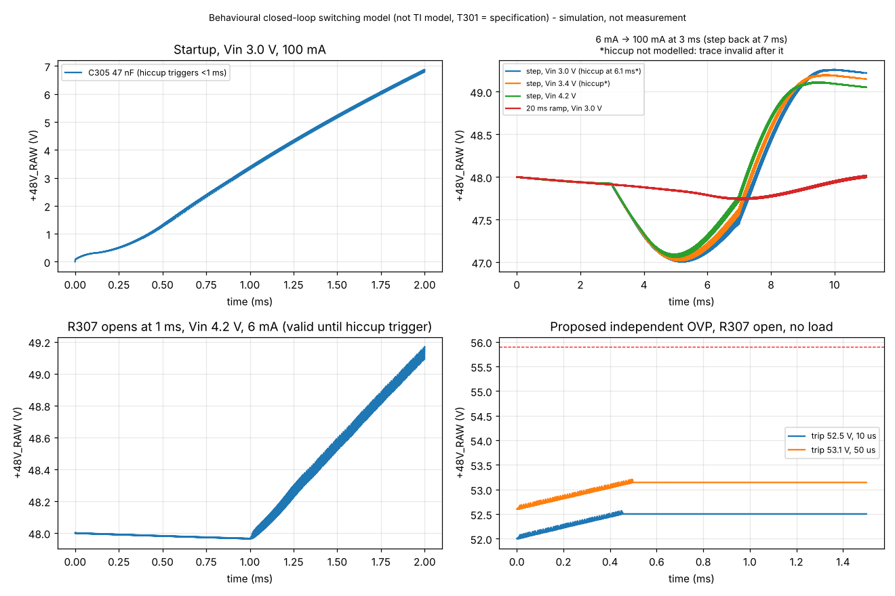
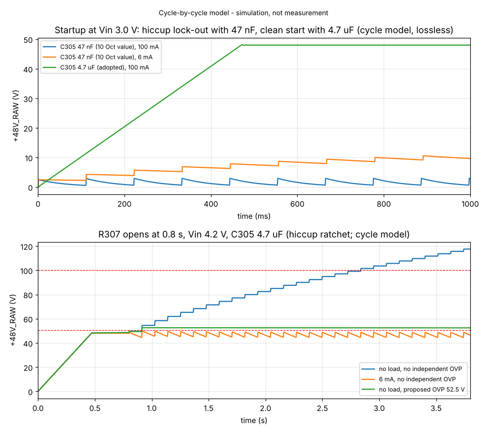
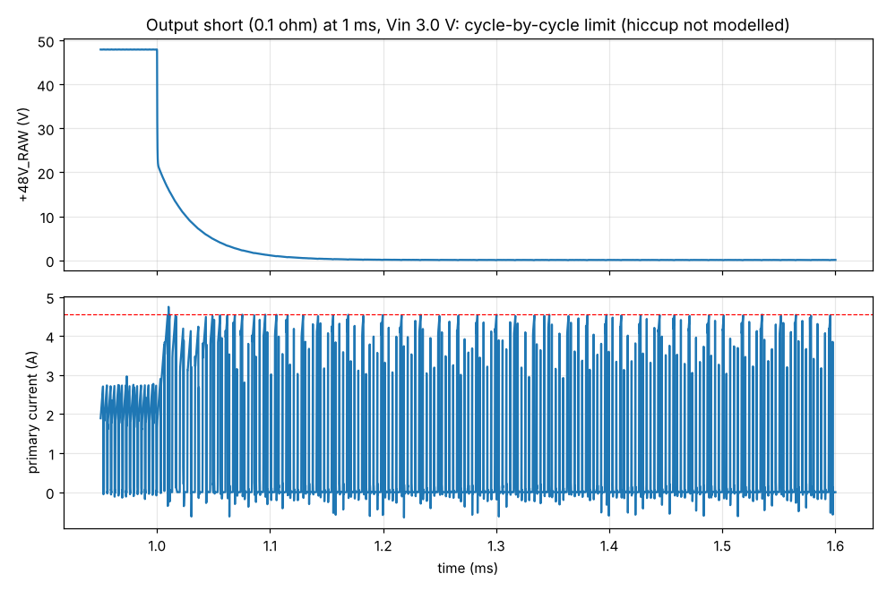

# Piezo Insulin Pump v2: Rev B digital design — engineering project report

| | |
| --- | --- |
| Project | Piezo Insulin Pump v2 (HybridPancreasSim v2), Rev B handover PCB |
| Owner | B Charan |
| Report date | 1 Nov 2026 (completion session) |
| Design state | Hardware commit `a768755` (C305 soft-start correction; ENC_I_M and VBAT_SENSE routed); kicad-cli 10.0.4 CI run 4 on that commit |
| Supersedes | The 21-section report of `b3734aa`/`7cc348e` (content reused and corrected; audit corrections A1–A12 retained) |
| Prepared with | Claude Code sessions of 10 Oct, 31 Oct and 1 Nov 2026, from repository evidence only |

> **Safety and scope.** This is a **bench-only prototype** for water or 0.9 % saline. It must **never be connected to a person or an animal**, and real insulin must never be used. It is a **digital design**: nothing has been fabricated, built or measured. This report is not a claim that the pump works, doses accurately, is safe for clinical use, or is ready for fabrication. A clean ERC/DRC report does not show that a circuit works.

### Milestone status (four separate milestones)

| Milestone | Status |
| --- | --- |
| Design complete | **No.** The STM32WBA55 power/RF circuit, transformer, independent OVP, SPI-gate runaway stop and 48 V switch/bleeder are undesigned or placeholders; 22 unconnected items |
| Ready for independent engineering review | **Yes, as a pre-release design review package**: every open item is listed with evidence (§31, `docs/handover/OWNER_APPROVAL_SHEET.md`) |
| Ready for fabrication | **No** (`docs/handover/FABRICATION_BLOCKERS.md`) |
| Hardware validated | **No.** No hardware exists |

### Evidence classification

Every important statement carries one of these labels:

| Label | Meaning |
| --- | --- |
| [DS] Manufacturer-datasheet verified | Read in a manufacturer document in `docs/datasheets/` |
| [REF] Reference-design backed | ST reference firmware configuration (`validation/logs/st_cubewba_evidence.md`) or a datasheet application section |
| [CALC] Calculated | Equation and inputs shown; reproduced by `scripts/audit_calcs.py` or the named script |
| [SIM] Simulated | Result of a model (named), **not a measurement** |
| [ASSUMED] Engineering assumption | Listed in `docs/handover/ASSUMPTIONS_AND_DEVIATIONS.md` or in the script header |
| [OWNER] Owner approval required | On `docs/handover/OWNER_APPROVAL_SHEET.md` |
| [NV] Not verified | No primary evidence available; [WEB-2ND] marks secondary web sources |

The design-value status field in the schematic (DECIDED, DS, CALC, ASSUMED, TBD, PLACEHOLDER) is unchanged and maps onto these labels. Verification sources are always named: **kicad-cli 10.0.4 in GitHub Actions** (real KiCad results), **pcbcheck.py** (the project's Python approximation, never equivalent to KiCad DRC), **LTspice/ngspice** and the **cycle-by-cycle Python model** (simulation).

### Evidence level of each part of the design

| Subsystem | Designed | Calculated | Simulated | Verified by KiCad | Hardware tested | Not yet implemented |
| --- | --- | --- | --- | --- | --- | --- |
| Battery path, fuse, switch | ✔ (parts partly TBD) | Current budget | — | ✔ ERC/DRC/parity | ✘ | Fuse part, pack connector, IPC-2152 width check |
| Charger BQ25188 | ✔ | Dissipation | — | ✔ | ✘ | Charge-current setting (firmware); YBG footprint check |
| 3.3 V buck TPS62840 | ✔ | — | — | ✔ | ✘ | — |
| 48 V flyback power stage | ✔ (transformer placeholder) | ✔ | ✔ open loop (LTspice + ngspice) **and closed loop (behavioural, 1 Nov)** | ✔ | ✘ | Real transformer, TI-model loop simulation, loop compaction |
| 48 V soft start | ✔ **corrected 1 Nov (C305 2.2 µF)** | ✔ | ✔ (two models) | ✔ | ✘ | — |
| 48 V over-voltage protection | LM51551 FB-based only | ✔ | ✔ open-FB fault, with and without the proposed OVP | ✔ | ✘ | **Independent OVP** [OWNER 1] |
| 48 V output switch / bleeder | Placeholders only | ✔ (bleeder) | ✔ (bleeder in open-FB fault) | ✔ (placeholders) | ✘ | [OWNER 3] |
| Kill path (enable, veto, park) | ✔ (owner-approved defaults) | ✔ thresholds | ✔ EN pull-down in the OVP case | ✔ | ✘ | SG tests |
| Runaway (speed) protection | Encoder to supervisor only | ✔ timing model | — | ✔ | ✘ | **SPI gate + supervisor firmware** [OWNER 2] |
| STM32WBA55 logic/pin map | ✔ (CubeMX-verified) | — | — | ✔ | ✘ | — |
| STM32WBA55 power / clock / RF | Placeholders; SMPS mode and LSE use reference-backed [REF] | — | — | ERC errors kept visible | ✘ | **ST documents needed** [OWNER 12] |
| STM32C031 supervisor | ✔ | — | — | ✔ | ✘ | Decoupling values (ST DS); VBAT input [OWNER 14] |
| PMD401 / encoder / RS-485 interfaces | ✔ (TVS parts TBD) | — | — | ✔ | ✘ | TVS selection, IF-02 level check |
| PCB layout | 4 layers; 76 of 93 multi-pad nets complete | — | — | ✔ 0 copper errors, **22 unconnected** | ✘ | 22 items (§21), human review |
| Firmware | Requirements only | — | (PC simulator outside repo) | n/a | ✘ | All (`docs/handover/FIRMWARE_DESIGN_REVIEW.md`) |

---

## Contents

1 Abstract · 2 Introduction · 3 Problem statement · 4 Project objectives · 5 Scope and limitations · 6 Complete system architecture · 7 Operating principle · 8 Piezoelectric motor operation · 9 Syringe mechanism · 10 Hardware architecture · 11 MCU design · 12 Supervisor architecture · 13 Motor controller interface · 14 Battery and charging · 15 Power electronics · 16 Flyback converter design · 17 Electrical calculations · 18 Component selection · 19 Complete schematic explanation · 20 PCB design and stack-up · 21 PCB routing and layout decisions · 22 Firmware architecture · 23 BLE communication · 24 Safety engineering · 25 Failure-mode analysis · 26 Simulation methodology · 27 Simulation results · 28 ERC/DRC verification · 29 BOM · 30 Risk assessment · 31 Unresolved issues · 32 Future development · 33 Fabrication requirements · 34 Bench-testing plan · 35 Conclusion · 36 References · Appendices A–B

---

## 1. Abstract

This report documents the Rev B digital design of a battery-powered piezoelectric syringe-pump bench prototype. A PiezoMotor LL06 Piezo LEGS linear motor, driven by a PMD401 driver from a 48 V rail, pushes the plunger of a 1 mL Hamilton glass syringe directly. An STM32WBA55 runs dosing and BLE; a dissimilar STM32C031 supervisor can only stop the motor. One Li-ion cell supplies everything through a BQ25188 charger, a TPS62840 3.3 V buck and an LM51551 non-isolated flyback to 48 V.

The schematic (147 symbols, 8 sheets) and a 4-layer, 110 × 85 mm PCB are generated from one Python source and verified by kicad-cli 10.0.4 in GitHub Actions: 0 copper DRC errors, 0 schematic–PCB parity issues, 22 unconnected items, ERC 6 intentional errors plus 1 cosmetic warning.

The flyback was analysed with datasheet calculations, open-loop LTspice/ngspice simulation and, in this revision, a behavioural closed-loop switching model and a cycle-by-cycle model of the LM51551. These revealed three problems. The 4.7 ms soft start would lock the converter into hiccup and it would never start; this is **corrected** (C305 2.2 µF). 100 mA load steps below about 4 V trip hiccup; a 20 ms firmware speed ramp avoids it. An open feedback resistor lets the rail ratchet past 100 V within seconds at no load, which supports the proposed independent over-voltage protection.

The design is **not complete and not ready for fabrication**: 17 owner decisions, ST and TI documents, a real transformer and independent review remain. No hardware exists, and the device must never be connected to a person or an animal.

---

## 2. Introduction

The owner's earlier v1 work combined a C++ closed-loop glucose simulator (HybridPancreasSim) with an ESP32, NEMA 17 and leadscrew syringe demonstrator. Version 2 replaces the stepper and leadscrew with a direct-drive piezoelectric motor and moves all control onto STM32 devices with BLE.

The Rev A bench build uses a purchased driver and development boards. Rev B is the integrated PCB. On 10 Oct 2026 the owner asked for a **digital Rev B handover design** before any Rev A results (DECISION_LOG §6). This report is the engineering record of that design: requirements, architecture, circuit and PCB design, calculations, simulations, verification, open issues and the path to fabrication.

How to read it: §6–§16 describe the design, §17–§21 its calculations, components and layout, §22–§25 firmware and safety, §26–§28 verification, and §29–§36 the BOM, risks, open issues and plans.

---

## 3. Problem statement

**Problem.** The owner's earlier v1 work was a C++ closed-loop glucose simulator (HybridPancreasSim) plus an ESP32 + NEMA 17 + leadscrew syringe demo. v2 must be smaller, all-STM32, closer to industry grade, and novel. It must also be honest about what is proven (U-1 to U-14).

The technical problem is to drive a 6.5 N piezo motor that needs a 48 V supply, from one 3.0–4.2 V cell, with dose resolution of 0.05 U (30 µm of plunger travel). A single fault in the controller, the power converter or the firmware must not be able to keep the motor running or the 48 V rail rising.

---

## 4. Project objectives

**Objectives**

| Objective | Requirement IDs | Status |
| --- | --- | --- |
| Dose water/saline correctly on the bench; success = gravimetric accuracy (±5 %) | U-4, D-11, D-12 | DECIDED; not yet testable (no hardware) |
| Piezo motor pushing a positive-displacement syringe directly | U-8, D-01, K-2, K-3 | DECIDED, designed in |
| All on STM32, BLE on the main MCU | U-2, U-11, K-6, K-17 | DECIDED, designed in |
| Fail-safe: every single fault ends in "48 V off, motor parked" | S-01 to S-04 | Partly designed in (§24) |
| Single 1S Li-ion cell, charger only for charging | E-01, E-09 | Designed in |
| Rev A bench build first, then a Rev B PCB | U-6, K-7 | **Changed 10 Oct**: the owner asked for a digital Rev B handover design now; fabrication still gated on Rev A results (DV-1) |
| Novelty: sensorless occlusion detection; fault-injection hardening (stretch) | U-9, K-13 | Firmware topics; not in this repository |

**Hard limits:**

- Lab prototype only: water/saline, bench, 18–28 °C, never on a person or animal (D-02, K-1).
- Every limit is an engineering target, not a clinical claim.

---

## 5. Scope and limitations

**In scope:** schematic, PCB, BOM, calculations, simulations, verification and handover documentation of the Rev B board. **Out of scope:** firmware (owner, K-16), enclosure, the PMD401 and LL06 themselves (bought parts), clinical use of any kind.

**Limitations of this work:**

- **No hardware, no measurements.** Every power, current, battery-life and timing figure is calculated or simulated.
- **The simulations are models.** The 1 Nov closed-loop model is behavioural (built from SNVSB75E numbers, not TI's model); the transformer is the specification; FET and diode models are generic. Agreement between models shows consistency, not hardware behaviour (§26).
- **Primary manufacturer documents could not be opened** for ST, JST, Coilcraft, IPC or Molicel. The session network policy blocked those sites. Web-search findings are labelled secondary and were not applied to the design.
- **KiCad version:** kicad-cli **10.0.4** (CI) was used instead of the 10.0.3 named in CLAUDE.md, because no 10.0.3 image exists. Same 10.0 file format.
- **Layout edits since 31 Oct** were made by script on the S-expression file; KiCad's CI checks confirm them electrically. Stored zone fills in the file are cut-back approximations. KiCad refills them for DRC (`--refill-zones`), but they should be refilled (**B**) in pcbnew before any output.
- **BOM data:** no Rev B sourcing data; many parts TBD.
- **Firmware:** none in this repository.
- **Manufacturer documents:** st.com, ti.com, distributors and Coilcraft were unreachable. ST's public GitHub repositories were reachable and were used only for reference firmware configuration [REF].

---

## 6. Complete system architecture

### 6.1 Block diagram



### 6.2 Interface list

| Interface | Connector | Signals | Notes |
| --- | --- | --- | --- |
| Battery | J101 XT30PW-M | VBAT_RAW, GND | Rev B connector OPEN (B.20) |
| Master switch | J102 5.08 mm terminal | VBAT_FUSED → VBAT | Off-board toggle ≥ 5 A |
| Charger input | J103 USB-C (power only) | VBUS, CC1/CC2 (5.1 kΩ Rd) | |
| PMD401 servo | J701 | SPI MOSI/SCLK/SS, AEN, 5 V out | Mode 3, ≤ 500 kbit/s (PMD401 manual) |
| PMD401 status | J702 | Ready, Fault, 5 V | |
| PMD401 48 V | J703 JST SM02B-SRSS-TB | +48V_MOT, GND | **Rating question, §17/§18** |
| RS-485 | J704 | A, B, GND | MAX3485 U701; R714 120 Ω DNP termination |
| LL06 encoder | J705 | I, GND, ENC_VCC, B, A, shield | ENC_VCC from 3V3 by default (JP701) |
| BLE RF | J501 U.FL | RF_ANT | Pi-match placeholder |
| SWD | J502 (main), J601 (supervisor) | 10-pin Cortex debug | |
| Console | J503 4-pin header | GND, CON_MAIN_TX, CON_SUP_TX, CON_SUP_RX | Moved between the MCUs on 31 Oct |

---

## 7. Operating principle

The pump is a closed-loop **position** servo on the plunger:

1. A dose request (BLE, with counter and check value) is converted to a target plunger travel: 1 U = 599 µm = 7489 encoder counts (§9) [CALC].
2. The main MCU enables 48 V, waits for FLY_PGOOD, unparks the PMD401 and sends a 16-bit **speed** word over SPI every < 10 ms (PMD401 servo mode) [DS PMD401 manual].
3. The LL06 moves the rod; its 80 nm encoder is counted by the main MCU (TIM2) and independently by the supervisor (TIM3).
4. When the target count is reached, the main MCU commands speed 0 and stops sending SPI frames. The PMD401 stops on its SPI timeout. The supervisor parks the motor and asserts the 48 V veto; the motor self-locks unpowered.

Safety rests on defaults rather than actions. 48 V is off unless the main MCU drives FLY_EN, the supervisor's veto is on unless it actively releases it, and the motor is parked unless the supervisor releases AEN (§24).

---

## 8. Piezoelectric motor operation

**Piezo LEGS LL06** (PiezoMotor; item LL06A0-101M1G1E2) [REPO, PMD401 manual DS]:

| Property | Value |
| --- | --- |
| Drive | Piezoelectric legs driven by four phase waveforms of 0–48 V |
| Step size | One full waveform cycle ("wfm-step", 8192 microsteps) gives **about 5 µm** of rod movement with no load; the step shrinks as load rises |
| Waveform | Update rate 65 kHz; maximum cycle rate 1500 Hz |
| Holding | Self-locking when unpowered (holding force > 6.5 N), so **"off" is the safe state** (S-01) |
| Force | 6.5 N stall; 0–3 N recommended working load |
| Speed | Top speed ≤ 15 mm/s (project record, `COMPONENTS_AND_BOM.md`); the PMD401's 1500 Hz × about 5 µm limits it to about 7.5 mm/s [DS]; power about 5 mW per Hz of step rate |
| Encoder | Integrated, 80 nm per count, quadrature A/B at 3.3–5 V |

The LL06 holds its position unpowered, so removing 48 V is a safe state. Its step length falls as load rises, which is the basis of the planned sensorless occlusion detection (§9).

---

## 9. Syringe mechanism

**Syringe and dose arithmetic** (Hamilton 81320, 4.61 mm bore; DESIGN_REQUIREMENTS §2) [CALC]:

| Quantity | Value |
| --- | --- |
| Plunger area | π × (4.61/2)² = **16.69 mm²** |
| Volume per µm of travel | 16.69 nL |
| 1 U (10 µL, U-100) | 599 µm = **7489 counts** |
| Smallest dose 0.05 U | 30 µm = 375 counts |
| One count | 1.34 nL = 0.00013 U |
| Full syringe 1 mL | 60 mm = 750 000 counts (32-bit position) |
| Speed cap 15 steps/s × ≈ 4.5 µm | ≈ 67.5 µm/s ≈ 0.11 U/s |
| Line pressure 1 bar | 1.67 N on the plunger (3.9 bar would stall the motor at 6.5 N) |

**Sensorless occlusion detection (the novelty, K-13).** Step length falls as load rises, so commanded waveform steps compared with encoder travel give an estimate of back-pressure without a pressure sensor. This is the project's central technical bet and **has not been demonstrated on hardware** (OPEN_QUESTIONS §D).

---

## 10. Hardware architecture

### 10.1 Hierarchical schematic

The schematic is generated from `scripts/design.py` (`docs/handover/pump_v2_schematic.pdf`). Sheet images are in `docs/report/figures/`.

| Sheet | Content | Figure |
| --- | --- | --- |
| Root | Sheet symbols | `figures/sch1_root.png` |
| Power input & charger | J101, F101, J102, BQ25188, USB-C, VBAT divider | `figures/sch2_power_input_charger.png` |
| 3V3 buck | TPS62840 | `figures/sch3_3v3_buck.png` |
| 48V flyback | LM51551, Q301, T301, D301, clamp, snubber, output | `figures/sch4_48v_flyback.png` |
| Kill path | FLY_EN network, supervisor veto, park driver | `figures/sch5_kill_path.png` |
| Main MCU | STM32WBA55CG, SWD, console, RF placeholders, crystals | `figures/sch6_main_mcu.png` |
| Supervisor | STM32C031C6, SWD, LED | `figures/sch7_supervisor.png` |
| PMD401 & encoder | J701–J705, TVS, series resistors, MAX3485 | `figures/sch8_pmd401_encoder.png` |



*Figure 10-1. 48 V flyback sheet (see also §19). The other sheets are in `figures/`.*

### 10.2 Circuit-level design choices

| Block | Design choice | Reason / source |
| --- | --- | --- |
| Battery path | Fuse after the cell connector, switch after the fuse, charger before the switch | E-01; charging possible with the switch off (A-14) |
| Charger isolation | BQ25188 SYS unloaded; load on VBAT | E-09 "never the load path" |
| VBAT sense | 1 MΩ/1 MΩ + 100 nF reservoir | BQ25188 has no ADC; INA219 dropped (DV-2, DV-13) |
| Logic rail | TPS62840 straight from VBAT | Isolates motor current spikes (constraint 23) |
| 48 V kill path | **FLY_EN = LM51551 UVLO/EN**: 4.7 kΩ pull-down (R401), main MCU via 1 kΩ (R402), supervisor veto Q401 BSS138 | K-10, re-checked against SNVSB75E (EN rising 0.4–0.7 V, UVLO 1.425–1.575 V). MCU high gives 2.72 V → run; pull-down only gives 0 V → off |
| Veto default | R403 10 kΩ **pull-up** on the BSS138 gate: veto ON whenever the supervisor is in reset or not driving PB0 low | Owner decision 10 Oct (closes OPEN item 3 / CF-9); deviation DV-3 |
| Park default | Q402 BSS138 open-drain on AEN with R405 10 kΩ gate pull-up: **parked by default**; the PMD401's 22 kΩ pull-up gives the run level | Owner decision 10 Oct (OPEN item 4); avoids a 3.3/5 V level question |
| PMD401 signals | TVS (D701–D709, parts TBD) + 100 Ω series on every line | E-07, PMD401 manual |
| Encoder fan-out | Encoder A/B through separate 100 Ω resistors to the main MCU TIM2 (R708/R709) **and** the supervisor TIM3 (R711/R712) | S-07, approved 10 Oct (DV-7) |
| Encoder supply | JP701 solder jumper: default +3V3 (bridged 1–2); option PMD401 5 V | OPEN item 12: the PMD401 5 V output dies with the 48 V rail, which could disturb the count |
| RS-485 | MAX3485 at 3.3 V; R714 120 Ω termination DNP, **placed at the connector (1 Nov)** | PMD401 has its own switchable termination |
| Flyback soft-start | C305 next to U301; FLY_SS reaches pin 9 through two vias; AGND pin 7 tied to the exposed pad | SNVSB75E §10.5.1 (31 Oct layout) |

---

## 11. MCU design

| | Main MCU U501 | Supervisor U601 |
| --- | --- | --- |
| Part | STM32WBA55CG (UFQFPN48 assumed, A-1) | STM32C031C6 (LQFP48 assumed, A-2) |
| Core / role | Cortex-M33, TrustZone, 1 MB flash, BLE radio: dosing, encoder counting (TIM2), PMD401 SPI and RS-485, BLE, charger I²C, VBAT ADC | Cortex-M0+ 48 MHz: heartbeat check, own encoder count (TIM3), 48 V veto, park line |
| Independence | Separate code base (F-09) | Dissimilar MCU so one fault cannot defeat both (22 Sep decision) |
| Pin map | 41 functions, verified against the STM32CubeMX 6.18.1 database (0 failures, `validation/logs/pinmap_check.md`) | Same check |
| Open | Supply/RF pins wait for ST documents (U-05); 5 V tolerance, ADC leakage, TIM2 width (U-10, U-11) | Decoupling, boot straps (A-7) |

**Main MCU pin functions** (from `docs/handover/HANDOVER_GUIDE.md` §4, CubeMX-verified):

- **PMD401 SPI3:** SCK PA0, MOSI PB8, NSS PA5.
- **Encoder (TIM2):** CH1 PB6, CH2 PA8, index PB14.
- **RS-485 (USART2):** TX PB0, RX PA11, DE PB1.
- **Heartbeat (LPUART1):** TX PB5, RX PA1.
- **Console:** USART1 TX PB12.
- **Charger I²C3:** SCL PA6, SDA PA7.
- **Control and status:**
  - 48 V enable: PB7.
  - PMD401 status: Ready PB15, Fault PB4.
  - Flyback power good: PA12.
  - Charger interrupt: PA2.
- **Analog:** VBAT sense PB9 (ADC4_IN10).
- **Other:** LED PB2; SWD PA13/PA14/PB3; BOOT0 PH3; RF on the RF pin; HSE 32 MHz; LSE 32.768 kHz.


**Status of the STM32WBA55 power and RF circuit** (U-05; see `docs/handover/ENGINEERING_BLOCKER_REVIEW_2026-11-01.md` §1):

- The SMPS inductor, VDD11, VDDHPA, VDDANA, VDDRF and VDDRFPA connections, the HSE/LSE load capacitors and the RF pi-match are **placeholders**. They cause the 6 intentional ERC errors and 12 unconnected items.
- ST's AN5948 (RF hardware) and AN6373 (SMPS) have been identified but not read. st.com is outside the session network policy. No value has been taken from memory or from another STM32 family.

**Reference-design evidence obtained on 1 Nov** [REF, `validation/logs/st_cubewba_evidence.md`]: ST's NUCLEO-WBA55CG BLE projects use `PWR_SMPS_SUPPLY`, a 32 MHz HSE crystal (SYSCLK 16 MHz = HSE/2) and a 32.768 kHz LSE crystal for the RTC and the radio sleep timer. The HAL driver documents an on-chip, user-programmable HSE trimming capacitor (`HSETRIM`, 0–63).

| A1 item | Status |
| --- | --- |
| Supply configuration, SMPS vs LDO | **SMPS recommended** [REF]; inductor value needs AN6373/DS14127 [OWNER 12a] |
| VDD11 and RF supplies, decoupling | Placeholders (C509–C513, R510–R513, L501) [NV] |
| Crystals | HSE Y501 fitted (part TBD); LSE Y502 DNP → **recommend fitting** [REF, OWNER 12c]; load capacitors C516–C518 DNP pending the datasheet (on-chip HSE trim exists [REF]) |
| RF matching and antenna | U.FL J501 + pi-match placeholder (L502, C514, C515) [NV] |
| Grounding and exposed pad | Pad 49 to GND with via array; final pattern per AN5948 [NV] |
| SWD | J502 10-pin Cortex debug (PA13/PA14/PB3, NRST) [DS CubeMX] |
| GPIO allocation, ADC | 41 functions CubeMX-verified; VBAT_SENSE on PB9 = ADC4_IN10 |
| Clock configuration | Firmware: HSE 32 MHz, LSE for RTC/radio timer [REF] |

---

## 12. Supervisor architecture

**Supervisor pin functions:**

- **Veto:** PB0 drives the BSS138 gate. High or high-Z means veto (via R403 pull-up).
- **Park:** PB1 drives the AEN open-drain gate. High or high-Z means parked (via R405).
- **Encoder (TIM3):** CH1 PA6, CH2 PA7.
- **Heartbeat (USART2):** TX PA2, RX PA3.
- **Console:** PA9/PA10.
- **Other:** LED PB2; SWD PA13/PA14; NRST PF2.

**Review against A2:**

| Item | Design | Finding |
| --- | --- | --- |
| Independent reset | Own NRST (PF2), own SWD, own clock | ✔ Independent of the main MCU |
| Watchdog | IWDG (firmware, F-07) | Not implemented. Recommend a timeout ≤ 10 ms. A hang plus a runaway is a double fault (0.75 U at 10 ms) [CALC `runaway_timing.py`] |
| Main-controller communication | Heartbeat UART (changing token, F-09) | Firmware only |
| Fault detection | Own encoder count (TIM3) | Rate check is a proposal [OWNER 2] |
| Motor shutdown | Veto (Q401) on FLY_EN; park (Q402) on AEN | ✔ Fail-safe by pull-ups (supervisor in reset → veto and park); the veto alone stops the motor only when the rail energy is spent (23–87 ms at 15 mm/s) |
| Battery monitoring | **None** | Gap: no supervisor VBAT input [OWNER 14] |
| Safe default states | Veto ON, park ON while in reset or unprogrammed | ✔ Designed (owner decisions 10 Oct) |
| Startup sequencing | Supervisor boots, checks heartbeat, then releases veto and park | Firmware only |

So the supervisor does **not** depend on the main MCU to stop the motor, but with the present hardware its stop paths are slower than S-06 requires at full speed. The proposed SPI gate closes that gap (§24).

---

## 13. Motor controller interface

The **PMD401** is used as bought (K-4); designing a custom piezo driver is prohibited (HARDWARE_CONSTRAINTS §1.2, 8). Facts from manual 150025-01 [DS]:

| Property | Value |
| --- | --- |
| Supply | 48 V DC ±5 % (45.6–50.4 V), "minimum 5 W" supply |
| Current | About 6 mA stopped; at most 100 mA at full speed |
| Board size | 59 × 39 mm |
| Servo mode (Y13 = 3) | The host sends a **16-bit signed speed** over SPI (≤ 500 kbit/s per the manual; the web page says more, conflict CF-16). The PMD401 **stops the motor if no SPI data arrives for about 10 ms** |
| Park | AEN low powers down (parks) the motor in about 250 ms; at least 80 ms to power up. AEN has a 22 kΩ pull-up and 10 nF to GND |
| Status outputs | Ready (low = ready) and Fault |
| Sensor connector | 5V Out, at most 0.2 A |
| Setup | RS-485 (servo mode with `X0Y13,3`, then `X0Y32` to save) |
| Signal protection | Signals have no EMC protection; the manual asks for series resistors and TVS diodes, which the design has (D701–D709, 100 Ω, E-07). The TVS parts are TBD (U-15) |

**Board-side drive design**

- **Main MCU path:** sets the speed by SPI, closes the position loop on its own encoder count, reads Ready/Fault, and uses RS-485 only for setup.
- **Supervisor path:** owns the park line through Q402 (open drain; parked by default) and the 48 V veto (§24).

---

## 14. Battery and charging

| Part | Value / status | Evidence |
| --- | --- | --- |
| Cell | Molicel INR18650-P28A on Rev A (K-9); Rev B cell OPEN (B.20) | Distributor data: 2800 mAh typical, 4.2 V charge, 35 A continuous [WEB-2ND] |
| Protection | 1S protected pack (K-12); 5 A fuse F101 (2920 SMD, part TBD) | E-01 |
| Master switch | Off-board, wired to J102 (5.08 mm terminal) | E-01, A-15 |
| Charger | **BQ25188YBGR**: 1 A linear charger; V<sub>IN</sub> operating 3.6–18 V (electrical table; the feature list says 3.0 V), VBATREG 3.5–4.65 V in 10 mV steps, 5–1000 mA fast charge, 55 mΩ battery FET, selectable thermal regulation T<sub>REG</sub> 60/80/100 °C [DS SLUSFJ3] | K-12 |
| Charger wiring | Charges on VBAT_FUSED (after the fuse, before the switch), so charging works with the switch off. **SYS is unloaded**, so the charger is never the load path (E-09) | A-14 |
| Defaults | VBATREG 4.20 V; ICHG 10 mA; I²C watchdog on (resets registers). **Firmware must set the charge current** | SLUSFJ3 §7.5 |
| TS pin | R101 10 kΩ, as the datasheet specifies when TS is unused (0.38 V vs the 90 mV button threshold) | DS |
| Battery sense | R107/R108 1 MΩ/1 MΩ + C104 100 nF into PB9: 4.2 V → 2.1 V; about 2.1 µA drain; τ = 50 ms | CALC (A-27: ADC leakage unverified) |

**Charge-current recommendation (proposal, owner decision):** about 0.5 A. As a linear charger from 5 V, the BQ25188 would dissipate 2.0 W at 1 A with a 3.0 V cell, in a 1.1 × 1.6 mm WCSP [CALC]. The repository datasheet's thermal table lists only the BQ25185 DLH package, so the YBG junction temperature cannot be computed; T<sub>REG</sub> reduces the charge current automatically if the die reaches the set limit.

**Runtime and peak current** [CALC `audit_calcs.py`; inputs ASSUMED where marked]:

| Quantity | Value |
| --- | --- |
| Cell energy (2.8 Ah × 3.6 V, [WEB-2ND]) | 10.1 Wh |
| Battery current at dosing speed (48 V load 0.36 W, η 80 %, 3.0 V) | 0.15 A |
| Battery current at the PMD401 maximum (100 mA at 48 V), 3.0 V | **1.93 A** closed-loop steady state [SIM]; 2.0–2.07 A open loop [SIM] |
| Idle budget for 3 days (E-10, 10 % reserve) | ≤ 0.13 W average |
| Low-voltage shutdown | Dosing stops at 3.4 V cell (S-13, firmware); TPS62840 in 100 % mode below about 3.4 V |
| Fuse | 5 A; full-speed current about 2 A |

The 48 V converter is power-limited at low cell voltage: a 100 mA load **step** below about 4 V trips hiccup (§27.2), so speed changes must be ramped (FW-R1).

---

## 15. Power electronics

| Rail | Source | Converter | Load | Notes |
| --- | --- | --- | --- | --- |
| VBAT_RAW → VBAT_FUSED → VBAT | Cell → J101 → F101 → J102 switch | — | All | Charger on VBAT_FUSED (§14) |
| +3V3 | VBAT | TPS62840 buck | Both MCUs, transceiver, encoder (default) | §15.1 |
| +48V_RAW → +48V_MOT | VBAT | LM51551 flyback | PMD401 via J703 | §16 |

### 15.1 3.3 V regulation

- **U201 TPS62840DLC** buck [DS SLVSEC6D]:
  - 1.8–6.5 V input, up to 750 mA, 60 nA operating quiescent current, 100 % duty mode.
  - VSET resistor R201 = 267 kΩ for 3.3 V.
  - L201 2.2 µH; C201 4.7 µF in; C202 10 µF out.
  - MODE = GND (auto PFM/PWM); EN tied to VIN.
- **Supply source:** taken from VBAT, not from the 48 V chain, so motor current spikes stay off the logic rail (constraint 23).
- **Low-cell behaviour (estimate, not derived from SLVSEC6D dropout data):** below about 3.4 V input the buck enters 100 % mode and +3V3 follows VBAT minus its dropout. E-02 requires ≥ 3.0 V while dosing, and S-13 stops dosing at 3.4 V cell.
- **Open conflict CF-8:** E-02's wording says "LDO", which is the Rev A MCP1700; Rev B uses the decided buck.
- **Planes:** +3V3 is distributed on the In2.Cu plane (3V3_L3 zone) everywhere except the VBAT regions (§20).

---

## 16. Flyback converter design

**Why a flyback.** A plain boost from 3.0–4.2 V to 48 V would need about 94 % duty and hits the controller's duty limit (29 Sep decision). A non-isolated flyback with n = 5 runs at D ≈ 0.70–0.77. It also has **no DC path from input to output when disabled**, which matters for the kill path (§24).

### 16.1 Design (FLYBACK_DESIGN.md; values in `scripts/design.py`)

| Quantity | Equation / basis | Result | Status |
| --- | --- | --- | --- |
| Controller | LM51551 (K-12), BIAS = VCC = VBAT (works from 2.97 V) | — | DECIDED / DS |
| Switching frequency | R<sub>T</sub> = 2.21×10¹⁰ / f<sub>SW</sub> − 955 | R301 73.2 kΩ → 298 kHz (±15 %) | CALC |
| Turns ratio | V<sub>out</sub> + V<sub>F</sub> = n·V<sub>in</sub>·D/(1−D) | n = 5 → D = 0.765 at 3.0 V, 0.70 at 4.2 V | CALC |
| Primary inductance | ΔI = 40 % of I<sub>pri,avg</sub> | L<sub>p</sub> = 7.3 µH (5–10 µH) | CALC |
| Peak primary | | 3.1 A (calc); 3.39 / 3.45 A (LTspice / ngspice) | CALC / SIM |
| Sense resistor | I<sub>lim</sub> = V<sub>CLTH</sub>/R<sub>s</sub>, V<sub>CLTH</sub> = 93–107 mV [DS] | R305 22 mΩ → 4.2–4.9 A | CALC |
| Soft start | t<sub>SS</sub> = C<sub>SS</sub>·V<sub>REF</sub>/I<sub>SS</sub>; charge current C<sub>out</sub>·48 V/t<sub>SS</sub> must stay well below the converter's capability or the 64-cycle hiccup trips [DS §9.3.10] | **C305 2.2 µF → 220 ms (198–247 ms)**, 33 mA charge current. The 10 Oct value 47 nF (4.7 ms) demanded 1.54 A and locked the converter in hiccup [SIM]; minimum 1.5 µF worst case | CALC / SIM; **changed 1 Nov** |
| Output divider | V<sub>out</sub> = V<sub>REF</sub>(1 + 470k/10k), V<sub>REF</sub> 0.99–1.01 V [DS] | 48.0 V nominal; **46.6–49.4 V** with 1 % resistors | CALC |
| Over-voltage | FB > 107/110/113 % of V<sub>REF</sub> [DS] | 52.8 V typical; **49.9–55.9 V worst case** (V<sub>REF</sub> ±1 %, 1 % divider); ≥ 7 % above the regulation point for any one part set; **sensed on FB only** | DS / CALC |
| Output capacitors | ΔV = I·D/(f·C) | 2 × 2.2 µF/100 V X7R + 47 µF/100 V; C702 100 µF/100 V at the connector | CALC / DECIDED |
| FET | CSD16340Q3, 25 V, 6.1 mΩ at V<sub>GS</sub> 2.5 V, Q<sub>g</sub> 6.5 nC, E<sub>AS</sub> 80 mJ [DS] | Gate drive = VBAT. V<sub>DS</sub> 18.4–18.7 V normal; up to ≈ 25.7 V at current limit [SIM] → [OWNER 9] | DS / SIM |
| Rectifier | PNE20010ER, 200 V / 1 A hyperfast [DS] | 100 V Schottky rejected (§27.1) | DS |
| Clamp | PMEG10020ELR (100 V/2 A [DS]) + R306 390 Ω 1 W + C308 22 nF | V<sub>DS</sub> 18.5–18.7 V (≈ 75 % of 25 V) | SIM |
| Snubber | R313 220 Ω + C312 100 pF/250 V C0G across D301 | D301 88–97 V (≈ 49 %) | SIM |
| Compensation | Type II, f<sub>c</sub> ≈ 3 kHz < f<sub>RHPZ</sub>/5 (≈ 30 kHz) | R303 3.01 kΩ, C306 180 nF, C307 3.3 nF | CALC, **preliminary** |
| Transformer T301 | n = 5, L<sub>p</sub> 7.3 µH, I<sub>sat</sub> ≥ 5 A, I<sub>rms</sub> ≥ 2.5 A, leakage ≤ 2 %, ≥ 100 V | **No part; placeholder footprint** | PLACEHOLDER |

### 16.2 Control-loop behaviour (closed-loop simulation, §27)

| Item | Result | Label |
| --- | --- | --- |
| Startup (C305 2.2 µF, 3.0 V 100 mA and 4.2 V 6 mA) | No hiccup, PGOOD at ≈ 209 ms, peak 48.2–48.4 V | SIM (cycle model; switching-model cross-check §27.2) |
| Load step 6 → 100 mA | Dip 0.9 V; **hiccup about 3 ms after the step at 3.0 and 3.4 V**, none at 4.2 V | SIM |
| Same load as a 20 ms ramp, 3.0 V | Dip 0.19 V, no hiccup, η ≈ 83 % | SIM |
| Unload 100 → 6 mA | Overshoot +1.3 V | SIM |
| Compensation | Stable in all runs with the **preliminary** R303/C306/C307; not a loop-gain measurement | SIM, preliminary |

### 16.3 Remaining work on this stage

1. Select the transformer [OWNER 7] and fit its footprint.
2. Re-tune the clamp and snubber to the real leakage, with V<sub>DS</sub> ≤ 20 V at current limit [OWNER 9].
3. Loop simulation with TI's model and the real T301, then a bench Bode measurement; finalise R303/C306/C307.
4. 0.1 % divider [OWNER 6]; independent OVP [OWNER 1].
5. Thermal check (R306, R305, Q301, D301, U301).

---

## 17. Electrical calculations

All figures are reproduced by `scripts/audit_calcs.py` (output `validation/logs/report_audit_calcs.txt`); equations and inputs are in the script with their sources. The flyback design equations are in §16.1.

| Calculation | Result |
| --- | --- |
| 48 V setpoint tolerance (V<sub>REF</sub> ±1 %, 1 % resistors) | 46.6–49.4 V vs E-03 45.6–50.4 V |
| OVP window | 52.8 V typical; 49.9–55.9 V worst case (upper end above the PMD401's 50.4 V) |
| Bleeder for E-11 (C<sub>max</sub> ≈ 180.8 µF, +20 % electrolytics assumed) | R ≤ 11.5–12.0 kΩ; with 10 kΩ: 4.4 s from 55.9 V, 4.2 s from 50.4 V, 3.5 s nominal; 0.25–0.31 W while on |
| Runaway budget S-06 (0.5 U = 300 µm) | 20 ms at 15 mm/s; 40 ms at the PMD401's 1500 Hz × 5 µm |
| PMD401 at dosing speed | ≈ 0.29 W idle + 0.075 W motor ≈ 0.37 W at 48 V → ≈ 0.15 A from a 3.0 V cell (PMD401 drive losses unknown) |
| Full-speed input current | 2.0–2.07 A at 3.0 V (sim) = the E-05 2.1 A budget |
| Battery life driver | Idle power dominates: E-10 (3 days on ≈ 10 Wh) needs average idle ≤ ≈ 0.13 W |
| Charger dissipation (linear, 5 V in) | 2.0 W at 1 A / 3.0 V; 1.0 W at 0.5 A / 3.0 V |
| FET voltage margin | 18.7 V / 25 V = 75 % normal (80 % rule met narrowly); ≈ 25.7 V at current limit [SIM] |
| Rectifier margin | 97 V / 200 V = 49 % |
| Soft start (new) | 47 nF: 4.7 ms, 1.54 A charge demand (fails). 2.2 µF: 198–247 ms, 33 mA |
| Unload overshoot vs PMD401 50.4 V | 1 % divider corner 49.4 V + 1.3 V = **50.7 V** (exceeds); 0.1 % corner 48.6 + 1.3 = 49.9 V |
| Runaway: maximum PMD401 SPI timeout for S-06 | 18.0 ms at 15 mm/s; 37.9 ms at 7.5 mm/s (2 ms worst-case detection) |
| Stored rail energy at 48 V | 174 mJ (151.4 µF) |
| Current limit with an 18 mΩ R305 (option) | 5.2–5.9 A → T301 I<sub>sat</sub> ≥ 6.5 A |

---

## 18. Component selection

**Status of the 147 schematic symbols** (counted from `hardware/kicad/*.kicad_sch`, 1 Nov):

| Status | Count | Meaning |
| --- | --- | --- |
| DECIDED | 26 | Locked by the owner (K-3 to K-6, K-10, K-12 parts, owner decisions of 10 Oct) |
| DS | 19 | Value or part taken from a datasheet in the repository |
| CALC | 19 | Calculated (flyback, dividers) |
| ASSUMED | 48 | Engineering assumption (A-1 to A-27); includes the 4 PWR_FLAG symbols |
| TBD | 11 | Part or value open |
| PLACEHOLDER | 24 | Block not designed (T301, 48 V switch, WBA55 supply/RF parts) |
| DNP | 17 | Not fitted (placeholders, options) |

**Key active and power parts**

| Ref | Part | Status | Evidence |
| --- | --- | --- | --- |
| U501 | STM32WBA55CG | DECIDED | CubeMX pin data; datasheet **not in repo** |
| U601 | STM32C031C6 | DECIDED | CubeMX pin data; datasheet **not in repo** |
| U101 | TI BQ25188YBGR | DECIDED | `docs/datasheets/bq25188.pdf` (SLUSFJ3) |
| U201 | TI TPS62840DLCR | DECIDED (variant ASSUMED) | `tps62840.pdf` (SLVSEC6D) |
| U301 | TI LM51551DSSR | DECIDED | `lm51551.pdf` (SNVSB75E) |
| Q301 | TI CSD16340Q3 | DS | `csd16340q3.pdf` |
| D301 | Nexperia PNE20010ER | DS | `PNE20010ER.pdf` |
| D302 | Nexperia PMEG10020ELR | DS | `pmeg10020elr.pdf` |
| Q401, Q402 | BSS138 | DECIDED | `bss138_nexperia.pdf` |
| U701 | MAX3485 | ASSUMED (carried from Rev A, DV-8) | Datasheet not in repo |
| T301 | Flyback transformer | **PLACEHOLDER** | Specification only |

**BOM files.**

- `docs/bom.csv` and `docs/bom_detailed.csv` had been generated on 10 Oct (Stage 2) and were **stale**: 131 references with pre-design-v2 statuses.
- On 1 Nov they were regenerated from the current schematic by `kicad-cli sch export bom` (kicad-cli 10.0.4, GitHub Actions [run 3](https://github.com/BigBiglinn/INSULIN_PUMP/actions/runs/41267788329), arguments identical to `scripts/run_checks.sh`).
- Result: **133 BOM references in 79 grouped lines**; test points, mounting holes and flags are excluded from the BOM.
  - Statuses: DECIDED 26, DS 19, CALC 19, ASSUMED 34, TBD 11, PLACEHOLDER 24.
  - 17 DNP.
- No Rev B supplier, price or stock data exists (COMPONENTS_AND_BOM §7.3).

**Selection classes (detailed BOM, §29):** final selection 10, final value/generic 18, datasheet value/generic 12, provisional 5, calculated 19, assumption 43, TBD 11, placeholder 8, DNP 17 (`docs/bom_full_summary.md`). Every 48 V-class part is checked in that summary. Capacitors are ≥ 100 V. R307 and the R309/R310/R312 placeholders need ≥ 75 V-rated parts; R313 ≥ 0.5 W [OWNER 6, 11]. J703 is provisional [OWNER 4].

---

## 19. Complete schematic explanation

| Sheet | Function | Key parts and nets | Design notes |
| --- | --- | --- | --- |
| Root | Hierarchy | 7 sheet symbols | Global labels carry inter-sheet nets |
| Power input & charger | Cell, fuse, switch, USB-C charging, battery sense | J101, F101, J102, J103, U101 BQ25188, R101 TS, R107/R108/C104 | Charger on VBAT_FUSED, SYS unloaded (E-09); 5.1 kΩ CC pull-downs |
| 3V3 buck | Logic supply | U201 TPS62840, L201 2.2 µH, R201 VSET | Direct from VBAT; isolates motor spikes |
| 48V flyback | 48 V for the PMD401 | U301 LM51551, Q301, T301 (placeholder), D301, D302/R306/C308 clamp, R313/C312 snubber, C309–C311, R307/R308, C305 soft start, R303/C306/C307 compensation, Q302/Q303/R309–R312 switch/bleeder placeholders, R311 0R bypass | FLY_EN = UVLO/EN; FB OVP only; C305 corrected 1 Nov |
| Kill path | Enable, veto, park | R401 4.7 kΩ pull-down, R402 1 kΩ from the main MCU, Q401 BSS138 veto + R403 pull-up, Q402 open-drain AEN + R405 | Every default is "off" (§24) |
| Main MCU | Dosing, BLE, interfaces | U501 STM32WBA55, Y501/Y502, L501/L502, C501–C519, J501 U.FL, J502 SWD, J503 console | Supply/RF parts are placeholders pending ST documents |
| Supervisor | Independent stop | U601 STM32C031, J601 SWD, LED | Encoder copy on TIM3; heartbeat UART |
| PMD401 & encoder | Off-board driver and motor | J701–J705, D701–D709 TVS (TBD), R702–R712 100 Ω series, U701 MAX3485, R714 DNP termination, JP701 encoder supply | Series R + TVS on every PMD401 line (manual) |


*Figure 19-1. 48 V flyback sheet. All sheets: `docs/report/figures/sch1_root.png` … `sch8_pmd401_encoder.png` and `docs/handover/pump_v2_schematic.pdf`. The figures predate the C305 value change; the value text on the PDF/PNG reads 47 nF, while the schematic file holds 2.2 µF.*

---

## 20. PCB design and stack-up

### 20.1 Stack-up and rules (`pump_v2.kicad_pro`, `gen_pcb.py`)

| Layer | Use |
| --- | --- |
| L1 F.Cu | Components, signals, GND pour |
| L2 In1.Cu | **Solid GND plane** (P-02) |
| L3 In2.Cu | Split: **VBAT** under the battery strip (x < 116 mm), along a bottom band and under the 48 V block (x > 155, y > 140.5 mm); **+3V3** everywhere else |
| L4 B.Cu | Signals, GND pour |

**Net classes:**

| Class | Clearance | Track | Via |
| --- | --- | --- | --- |
| Default | 0.15 mm | 0.2 mm | 0.6/0.3 mm |
| PWR | 0.2 mm | 0.8 mm | 0.7/0.35 mm |
| **HV48** (+48V_RAW, +48V_MOT, FLY_SEC) | **0.6 mm on all layers** | 0.4 mm | 0.6/0.3 mm |
| RF | 0.2 mm | 0.3 mm | 0.6/0.3 mm |

**Board rules (generic):**

- Minimum track 0.15 mm; minimum via 0.5/0.3 mm.
- Copper-to-edge 0.3 mm.
- Two scoped DRU exceptions:
  - J703 pad-to-pad 0.35 mm (vendor connector pitch);
  - Q301 pad-to-pad 0.127 mm (NexFET pad pitch). The audit compared the footprint with TI SLPS247E §7.2: it matches within 5 µm, but TI's pads sit at a uniform 0.65 mm pitch (0.15 mm gaps), so moving the four pads to TI's exact positions would remove this exception (proposal, owner approval).
- The fab and its rule file are not chosen (U-16). The stack-up is KiCad's default 1.6 mm, so the RF trace is not impedance-controlled (U-20).

### 20.2 Placement

Functional zones:

| Zone | Location |
| --- | --- |
| Power input and charger | Left edge |
| MCUs | Centre |
| PMD401 and encoder connectors | Right edge |
| 48 V flyback block | Bottom right |
| U.FL connector | Top edge |

Layout changes made on 31 Oct and 1 Nov:
- **31 Oct:** C305, TP302 and J503 moved.
- **1 Nov:** R714 moved.

These positions are also recorded in `gen_pcb.py` `ANCHORS`.



*Figure 20-1. Whole board, current state (drawn by `scripts/pcbplot.py` from the board file; not a KiCad render). The 10 Oct KiCad renders are in `docs/handover/images/`.*

Board outline 110 × 85 mm; 147 footprints; GND plane on In1.Cu under the whole board. The flyback switching loop (C302/C303 → T301 → Q301 → R305 → GND) is placed compactly but routed around a placeholder transformer footprint, so loop area is not final. The RF section sits at the top edge near J501, but its geometry follows no ST reference yet.

---

## 21. PCB routing and layout decisions

| Date | Method | Unconnected | Evidence |
| --- | --- | --- | --- |
| 10 Oct | Freerouting 2.1.0 (3 passes) + DRC-gated hand router | 63 → 35 | kicad-cli 10.0.3 (`validation/drc/baseline_2026-10-10/`) |
| 31 Oct | `layout_fixes.py`: +48V_MOT, FLY_SS, TP302, J503 console, ENC_A_S, stub clean-up | 35 → 28 | kicad-cli 10.0.4 CI run 1 on `ab69cdf`: 28, 0 copper errors, **3 dangling tracks missed by the Python checker** |
| 1 Nov | `layout_fixes_2.py`: ENC_VCC, ENC_I, RS-485 termination, +3V3 at R302.2, remaining stubs | 28 → 24 | kicad-cli 10.0.4 CI run 2 on `ef091c3`: 24, 0 copper errors, 0 dangling |
| 1 Nov (completion) | `layout_fixes_3.py`: ENC_I_M (31.9 mm, 2 vias), VBAT_SENSE (33.4 mm, 4 vias) | 24 → **22** | kicad-cli 10.0.4 CI run 4 on `a768755`: 22, 0 copper errors, 0 parity |



*Figure 21-1. U301 area after the 31 Oct soft-start rework.*



*Figure 21-2. +48V_MOT route to J703.*

**The 22 remaining unconnected items** (kicad-cli, `validation/drc/pump_v2-drc.rpt`), in the dependency order in which they must be closed:

| Order | Class | Count | Items | Blocker |
| --- | --- | --- | --- | --- |
| 1–2 | STM32WBA55 power, RF and crystals | 12 | WBA_VDD11 ×2, WBA_VDDANA, WBA_VDDRF, WBA_VDDRFPA, RF_MCU, HSE_IN ×2, HSE_OUT ×2, LSE_IN ×2 | ST documents [OWNER 12] |
| 3 | BQ25188 | 3 | VBAT_FUSED, CHG_INT_N, I2C_SDA (→ U101.C1) | TI YBG drawing [OWNER 16] |
| 4–6 | PMD401 SPI/status, SWD, flyback PGOOD | 6 | PMD_SCLK_M, PMD_MOSI_M, PMD_READY_M, MAIN_SWCLK, FLY_PGOOD, I2C_SDA (→ U501.6) | Pins boxed in until U501 is re-fanned-out with the ST layout |
| 7 | 48 V output switch | 1 | SW48_GATE | [OWNER 3]: disappears with option A |
| 8 | Encoder / communication | 0 | — | ENC_I_M and VBAT_SENSE routed 1 Nov |

No route was forced through congested or high-voltage areas. Both new routes keep ≥ 0.19 mm from other nets (default clearance 0.15 mm) and stay outside the HV48 area [pcbcheck.py; confirmed by kicad-cli].

**Not yet done by any step:**

- Flyback loop compaction (FL-1 to FL-4); it depends on T301.
- Impedance-controlled RF.
- IPC-2152 current-width check of the battery path.
- A full human review of autorouted copper.

---

## 22. Firmware architecture

**No firmware is stored in this repository.** The owner writes the firmware personally (K-16). A reference implementation and a staged course exist outside the repository (`pump_config.h`, `pump_port.h`, `dose_ctrl.c`, `load_est.c`, `hardened.h`, `port_stm32wba.c`, `pump_app.c`, `sim_plant.c`, `test_main.c`). As of 29 Sep, the supervisor firmware and the BLE input were still to be written. Everything below is a requirement, not an implementation.

| Area | Requirement |
| --- | --- |
| Structure | Plain C11 behind one hardware boundary `pump_port.h`; the same dosing code runs on the PC simulator and the target (F-01) |
| Dose state machine | IDLE → UNPARK → MOVE → SETTLE → IDLE, FAULT reachable from every state (F-02) |
| Hardening | Complement-stored values, doubled limit checks with random delay, encoded booleans, control-flow counter (F-03); glitch testing is a stretch goal (C-07) |
| Position | 32-bit position; 16-bit timers extended in firmware if needed (FW-08) |
| Limits | 0.05 U minimum, 10 U bolus, 15 U per rolling hour, for every command source (S-05, C-04) |
| Watchdogs | IWDG and brown-out reset on both MCUs (F-07, proposed) |
| Supervisor | Separate code base; heartbeat is a changing token (F-09, proposed) |
| Coding standard | MISRA C:2025 on safety modules (F-04, proposed) |

**Design review (1 Nov):** `docs/handover/FIRMWARE_DESIGN_REVIEW.md` checks each firmware function against the hardware and lists everything not implemented. New firmware requirements from this revision:

- **FW-R1:** ramp PMD401 speed changes over ≥ 20 ms (§27.2).
- **FW-R2:** after enabling 48 V, wait for FLY_PGOOD (soft start now about 220 ms).
- **FW-R3:** send no SPI keep-alive when stopping; the timeout is the stop mechanism.
- **FW-R4:** supervisor IWDG ≤ 10 ms.

Firmware limits are never the only protection, by design (§24). Until the SPI gate exists, however, the speed cap in main-MCU firmware is the only fast stop.

---

## 23. BLE communication

BLE is implemented in the STM32WBA55's integrated radio (K-6, K-17) through a U.FL connector to an external antenna; the matching network is a placeholder until AN5948 is available.



**Other communication requirements:**

- **RS-485** is used for PMD401 setup only.
- **BLE security:** LE Secure Connections with passkey or numeric comparison, bonded (C-02, proposed).
- **Debug:** SWD locked on Rev B (C-06, proposed).
- **Link loss and the CGM protocol** are undefined (OPEN item 16).

---

## 24. Safety engineering

**Safe state (S-01):** 48 V rail off, motor parked and clamped. The LL06 self-locks when unpowered.

**Fail-safe mechanisms in the hardware design**

| Mechanism | How it works | Default if a controller is dead | Status |
| --- | --- | --- | --- |
| 48 V default-off (S-02, K-10) | FLY_EN pulled to 0 V by R401 4.7 kΩ; the main MCU must drive it through R402 1 kΩ | Main MCU dead or reset → 0 V → LM51551 shut down; a flyback has no DC input→output path | Designed |
| Supervisor veto | Q401 BSS138 shorts FLY_EN; gate pulled **up** by R403 | Supervisor dead or reset → veto ON → 48 V off | Designed (owner decision 10 Oct) |
| Park | Q402 open-drain on AEN, gate pulled up by R405 | Supervisor dead → parked | Designed (owner decision 10 Oct) |
| PMD401 SPI timeout | Motor stops about 10 ms after the last SPI word | Main MCU stops talking → stop | Inherent in the PMD401 |
| Firmware safe-halt | Corruption detection → halt (S-03 path 3) | — | Firmware not in repo |
| Independent travel check | Encoder A/B to the supervisor TIM3 (S-07) | — | Hardware done; firmware not in repo |
| Rail discharge | E-11 < 5 V in 5 s | — | **Bleeder not fitted (U-06)**; R312 10 kΩ proposed [OWNER 3] |
| Over-voltage | LM51551 OVP on FB (52.8 V typ, 49.9–55.9 V worst case) | — | **Single-fault gap: open FB divider (U-23)** |

**Known gaps (critical):**

1. **Speed cap only in main-MCU firmware (S-06).**
   - A runaway at the 15 mm/s top speed delivers S-06's 0.5 U in about **20 ms**.
   - Park (250 ms) is too slow. The 48 V veto is unproven, because the PMD401's behaviour as its supply decays is unknown.
   - A supervisor-controlled SPI gate would use the PMD401's ~10 ms timeout: 2 ms worst-case detection + 10 ms = 0.30 U [CALC `runaway_timing.py`]; S-06 holds only if the timeout is ≤ 18 ms [OWNER 2].
2. **No over-voltage protection independent of R307/R308** (U-23). With R307 open, the LM51551 runs at current limit until its hiccup counter stops it, then restarts every 110 ms. At no load the rail ratchets past 50.4 V in 112 ms, 55.9 V in 336 ms and 100 V in 2.9 s [SIM, §27.3]. With the PMD401 idle load or a 10 kΩ bleeder it sags instead.
3. **J703 rating.** Distributors list 50 V for the SH series, below the 50.4 V normal maximum and the up-to-55.9 V OVP ceiling [WEB-2ND].
4. **Resistor working voltage on 48 V nodes.** R307 (470 kΩ, FB divider top) is an 0603 with no MPN and sees about 47 V (up to about 55 V). Its datasheet working voltage must be ≥ 69 V (80 % rule); an R307 open-circuit is exactly the U-23 single fault (U-38).
5. Buzzer and STOP button not on the board (owner decision 10 Oct; S-12 proposed).

---

## 25. Failure-mode analysis

Single-fault analysis of the safety functions (bench prototype; S/D = severity/detectability, H/M/L). "Present" is the committed design; "proposed" adds the approval-sheet items.

| # | Failure | Effect (present design) | Detection / mitigation (present) | Residual (present) | With proposed changes |
| --- | --- | --- | --- | --- | --- |
| FM-1 | Main MCU firmware commands excess speed | Over-delivery: 0.5 U in 20 ms at 15 mm/s | Firmware cap; supervisor veto/park (slow) | **H**: exceeds S-06 | SPI gate + rate check: 0.30 U (10 ms timeout) [CALC] |
| FM-2 | Main MCU hangs while the motor moves | PMD401 stops after its SPI timeout (≈ 10 ms) | Inherent PMD401 behaviour | M: timeout not guaranteed | Same + supervisor block |
| FM-3 | Supervisor hangs | No independent check; defaults unchanged until IWDG reset | IWDG reset → pull-ups veto and park | L (single fault): no motion is caused | Same; IWDG ≤ 10 ms |
| FM-4 | R307 open (FB top) | FB = 0 → current limit → hiccup ratchet; rail rises at light load | None independent | **H** (no load: 100 V in 2.9 s) [SIM] | Independent OVP latches at ≈ 52.5 V [SIM] |
| FM-5 | R308 short / FB shorted to GND | As FM-4 | As FM-4 | H | As FM-4 |
| FM-6 | R308 open | FB → V<sub>out</sub> through R307 → internal OVP stops switching → rail collapses | LM51551 OVP | L (fails low) | — |
| FM-7 | Q301 drain-source short | Battery shorted through T301 primary and R305 | F101 5 A fuse, cell protection | M | — |
| FM-8 | D301 short | Secondary shorted → current limit → hiccup | LM51551 hiccup | L | — |
| FM-9 | Output short (cable) | Current limit, hiccup within 0.23 ms; 0.19 % burst duty [SIM] | Hiccup | L | — |
| FM-10 | FLY_EN stuck high (Q401 open) | 48 V cannot be vetoed | Park still works; SPI timeout | M | SPI gate independent of FLY_EN |
| FM-11 | Encoder failure (no counts) | Main position loop runs open; supervisor sees no motion | None today | **H** | Plausibility check commanded vs measured (FW) |
| FM-12 | Battery disconnect while moving | 3V3 and 48 V collapse; SS floats high → stop | Inherent | L (1.3 µm overrun at dosing speed) [CALC] | — |
| FM-13 | J703 arcing / insulation (50 V part at 48–56 V) | Intermittent 48 V | None | M | ≥ 100 V connector [OWNER 4] |
| FM-14 | PMD401 internal fault drives without SPI | Motor runs until the rail energy is spent after veto | Supervisor rate check + veto | **H** (0.6–2.2 U) [CALC] | No board-level fix; documented residual risk |
| FM-15 | Load step at low battery | Hiccup → 48 V off 110 ms → PMD401 brown-out mid-move | None | M | FW-R1 ramp [SIM] |

---

## 26. Simulation methodology

Three model levels, each with stated scope. No model includes the real transformer (T301 is a placeholder), so every flyback result is conditional on the transformer **specification**.

| Level | Tool / script | What it models | What it does not model | Use |
| --- | --- | --- | --- | --- |
| 1. Open-loop power stage | LTspice 26.1.1 (`validation/sim/flyback_openloop.cir`); ngspice 42 re-run (`scripts/sim_flyback_ngspice.py`) | Switching power stage at fixed duty: transformer spec with k = 0.99, clamp, snubber, generic FET and diode models | Controller | Stresses (V<sub>DS</sub>, D301), efficiency, ripple |
| 2. Closed-loop switching | ngspice 42 (`scripts/sim_flyback_closedloop.py`) | Level 1 + a behavioural LM51551: 298 kHz clock, peak-current PWM with GCOMP 0.142 and 40 mV slope, VCLTH 100 mV, tON(min) ≈ 140 ns, Gm 2 mA/V EA with the schematic compensation, COMP clamps, soft start, FB OVP, UVLO/EN; optional proposed OVP latch | The hiccup timer (applied afterwards to the per-cycle current-limit flag); COMP offset 1.0 V and DMAX 90 % are assumptions; not TI's model | Startup, load steps, faults over ms windows |
| 3. Cycle-by-cycle | Python (`scripts/sim_flyback_cycle.py`) | Exact piecewise-linear flyback per switching period + the same controller **with hiccup** (64/8/32 768 cycles) | Leakage, clamp and switching losses (so it is optimistic on power, pessimistic for over-voltage) | Long horizons: soft-start sizing, open-FB fault over seconds, shorts |

**Cross-checks:** level 2 and level 3 agree on the 47 nF startup (rail 2.45 V vs 2.44 V at 1 ms; hiccup trigger 0.78 ms vs 0.65–0.73 ms) and on the output short (hiccup 0.235 ms vs 0.225 ms after the short). Level 1 and level 2 agree on steady-state stress (V<sub>DS</sub> 18.4–18.7 V, D301 88–89 V at 3.0 V/100 mA).

**Validity rules.** A run that aborts or does not converge is discarded. Two such cases occurred and were rerun after the cause was fixed: the 1 Nov diode COMP clamp failed at t = 0 and was replaced by a piecewise-linear clamp, and the earlier no-snubber open-loop runs remain flagged invalid. A level-2 waveform is **invalid after the computed hiccup time**, because the real device would stop switching. Every result is a simulation, not a measurement.

**Fault-timing model:** `scripts/runaway_timing.py` (calculation) combines encoder-rate detection windows, the PMD401 SPI timeout band (5–20 ms, ASSUMED), IWDG periods and stored rail energy.

---

## 27. Simulation results

### 27.1 Open-loop power stage (levels 1)

- **Netlist:** `validation/sim/flyback_openloop.cir`.
- **ngspice translation:** `scripts/sim_flyback_ngspice.py` → `validation/sim/ngspice/`.
- **Model scope:** ideal fixed-duty gate drive (no LM51551 model); the transformer is the specification (k = 0.99, about 2 % leakage); generic FET and diode models approximating the datasheets; 480 Ω load = 100 mA.

| Case (snubber fitted) | Simulator | V<sub>out</sub> avg | V<sub>out</sub> p-p | I<sub>pri</sub> pk | V<sub>DS</sub> max | D301 reverse max | I<sub>in</sub> avg | η | P<sub>clamp</sub> |
| --- | --- | --- | --- | --- | --- | --- | --- | --- | --- |
| 3.0 V in | LTspice | 48.48 V | 0.138 V | 3.39 A | 18.49 V | 88.5 V | 2.03 A | 0.82 | 0.415 W |
| 3.0 V in | ngspice | 48.82 V | 0.162 V | 3.45 A | 18.70 V | 89.0 V | 2.07 A | 0.80 | 0.425 W |
| 4.2 V in | LTspice | 49.93 V | 0.144 V | 2.74 A | 18.51 V | 97.1 V | 1.47 A | 0.85 | 0.352 W |
| 4.2 V in | ngspice | 49.88 V | 0.126 V | 2.72 A | 18.44 V | 97.1 V | 1.46 A | 0.85 | 0.348 W |

**Cases without the snubber:**

- **LTspice** showed D301 ringing to its 200 V breakdown, which is why the snubber was added.
- **ngspice** did not converge to a physical steady state (output power exceeded input power), so those runs are flagged invalid and not used.

**Agreement between the two simulators.** V<sub>out</sub> 0.1–0.7 %, I<sub>pk</sub> 0.7–1.8 %, V<sub>DS</sub> 0.4–1.1 %, D301 stress 0–0.6 %, I<sub>in</sub> 0.7–2 %, P<sub>clamp</sub> 1–2.4 %. **Output ripple differs by −12 to +17 %**, and efficiency by 2 points at 3.0 V.



*Figure 27-1. ngspice waveforms, 3.0 V in, 100 mA, snubber fitted. The primary peak (3.45 A) occurs at switch-on (D301 reverse recovery reflected), not at the end of the ramp (about 3.1 A). The off-state drain plateau is about 12.9 V (V<sub>in</sub> + V<sub>out</sub>/n). D301 sees about 63 V steady-state (V<sub>out</sub> + n·V<sub>in</sub>) with an 89 V spike.*

### 27.2 Closed loop: startup, load steps and soft-start sizing (levels 2 and 3)

| Case (C305 2.2 µF unless stated) | Result | Source |
| --- | --- | --- |
| C305 47 nF, 3.0 V, 100 mA | Current limit within 1 ms, **hiccup at 0.78 ms**; rail stuck below 9 V after 6 hiccup cycles in 0.6 s | level 2 + 3 |
| C305 sweep, worst case (V<sub>CLTH</sub> 93 mV, I<sub>SS</sub> 11 µA, V<sub>REF</sub> 1.01, 3.0 V) | 47–680 nF: hiccup. 1 µF: hiccup at 100 mA. **≥ 1.5 µF: clean start** at 6 mA and 100 mA | level 3 |
| 2.2 µF, 3.0 V, 100 mA / 4.2 V, 6 mA | PGOOD at 209 ms, V<sub>max</sub> 48.2–48.4 V, no hiccup | level 3 |
| Load step 6 → 100 mA, 3.0 V | Dip to 47.0 V; **hiccup trigger 3.1 ms after the step** | level 2 |
| Load step 6 → 100 mA, 3.4 V | Dip to 47.0 V; **hiccup trigger 3.2 ms after the step** | level 2 |
| Load step 6 → 100 mA, 4.2 V | Dip to 47.1 V; no hiccup; unload overshoot +1.2 V | level 2 |
| 20 ms ramp 6 → 100 mA, 3.0 V | Dip 0.19 V (47.74 V), **no hiccup**, I<sub>pk</sub> 3.39 A, V<sub>DS</sub> 18.4 V, D301 88 V; 100 mA steady state: I<sub>in</sub> 1.93 A, η ≈ 83 % | level 2 |
| Unload 100 → 6 mA | +1.3 V overshoot (3.0 V) | level 2 |



*Figure 27-2. Level-2 switching model: startup, load steps and ramp, R307-open fault, proposed OVP trip. Traces after a computed hiccup time are not valid.*



*Figure 27-3. Level-3 cycle model: soft-start lock-out with 47 nF versus clean start with 2.2 µF; R307-open fault ratchet with and without the proposed OVP.*

### 27.3 Faults: open feedback resistor, proposed OVP, short circuit

| Case (Vin 4.2 V) | Result | Source |
| --- | --- | --- |
| R307 opens, PMD401 idle (6 mA) | Hiccup 0.38 ms after the fault; rail **sags** to below regulation (max 48.8 V) | level 2 + 3 |
| R307 opens, 10 kΩ bleeder only | Rail sags (max 49.0 V) | level 3 |
| R307 opens, **no load** | Ratchets: > 50.4 V after 112 ms, > 55.9 V after 336 ms, > 60 V after 450 ms, **> 100 V after 2.9 s** | level 3 |
| R307 open, no load, proposed OVP 52.5 V / 10 µs | Latched at 52.5 V; switching stops immediately after the latch; overshoot after the trip 0.07 V | level 2 + 3 |
| Same, OVP at the band edge 53.1 V / 50 µs | Latched at 53.2 V | level 2 + 3 |
| During current-limit operation at V<sub>out</sub> ≥ 48 V | **V<sub>DS</sub> ≈ 25.7 V** (at the 25 V model breakdown); D301 ≈ 104 V | level 2 |
| Output short 0.1 Ω (3.0 V) | Primary peak held at 4.95 A; hiccup 0.235 ms after the short; burst duty 0.19 % | level 2 + 3 |



*Figure 27-4. Output short at 1 ms (level 2): cycle-by-cycle current limit until the hiccup time.*

### 27.4 Runaway fault timing (calculation)

`validation/logs/runaway_timing.txt`. At 15 mm/s: SPI gate + 10 ms timeout → 0.30 U (pass); with a 20 ms timeout → 0.55 U (fail); the veto alone → 0.63–2.2 U (fail); park only → 6.3 U (fail). Slow-tier detection (0.10–0.8 mm/s) → ≤ 0.29 U. Supervisor hang + runaway (double fault) → 0.75–3.0 U.

### 27.5 What the simulations do not show

Real transformer behaviour, loop phase margin, thermal behaviour, EMI, the PMD401's response to a decaying supply, and any measured value.

---

## 28. ERC/DRC verification

| Check | Tool | Result | File |
| --- | --- | --- | --- |
| ERC | **kicad-cli 10.0.4** (GitHub Actions run 41272581019, commit `a768755`) | 6 × `power_pin_not_driven` (intentional, U-05) + 1 × `lib_symbol_mismatch` (U701, cosmetic). No PWR_FLAG added to hide them | `validation/erc/pump_v2-erc.rpt` |
| DRC copper (clearance, shorts, holes, edge, courtyards, dangling, thermals) | **kicad-cli 10.0.4**, `--refill-zones` | **0** | `validation/drc/pump_v2-drc.rpt` |
| Schematic parity | **kicad-cli 10.0.4**, `--schematic-parity` | **0 issues** | CI log |
| Unconnected | **kicad-cli 10.0.4** | **22** (§21) | same |
| Silkscreen | **kicad-cli 10.0.4** | 69 overlap, 52 over copper, 1 edge (D704) — cosmetic | same |
| Pin map | STM32CubeMX 6.18.1 database (10 Oct) | 41/41 functions, 0 failures | `validation/logs/pinmap_check.md` |
| Python checker calibration | `scripts/pcbcheck.py` vs kicad-cli | Matched unconnected count and copper errors on 10 Oct, 31 Oct and 1 Nov boards. **Missed 3 dangling track ends on 31 Oct** (test corrected 1 Nov) | `validation/logs/pcbcheck_2026-1*.txt` |
| Power stage | LTspice 26.1.1 + ngspice 42 + Python cycle model | §27 | `validation/sim/` |

**Distinctions that matter:**

1. **Software validation is done** for ERC, DRC and parity on the current board, plus open-loop simulation.
2. **Bench validation has not started:** the whole of `requirements/VALIDATION_PLAN.md`, including the PW, SG, MT and DA groups.
3. **Manufacturing acceptance has not started:** no fab, no DFM review, no Gerbers.
4. A clean ERC/DRC report does not show that the circuit works.

**Validation record (this revision):**

| Check | Tool, version | Date | Input commit | Result | Remaining issues |
| --- | --- | --- | --- | --- | --- |
| ERC | kicad-cli 10.0.4 (CI run 4) | 1 Nov 2026 | `a768755` | 6 errors (intentional, U-05) + 1 warning (U701 symbol) | ST documents |
| DRC + parity | kicad-cli 10.0.4 (CI run 4), `--refill-zones --schematic-parity` | 1 Nov 2026 | `a768755` | 0 copper, 0 parity, 0 footprint errors, 22 unconnected, 122 silk | §21, silk clean-up |
| BOM export | kicad-cli 10.0.4 (CI run 4) | 1 Nov 2026 | `a768755` | 133 refs; only C305 changed | — |
| Python checker | `pcbcheck.py` (Python 3.13, shapely) | 1 Nov 2026 | `a768755` | 22 unconnected on 17 nets, 0 clearance, 0 dangling — **matches kicad-cli; not a substitute for it** | — |
| BOM consistency | `gen_bom_full.py` | 1 Nov 2026 | working tree after `a768755` | Reference set identical to the kicad-cli export | — |
| Calculation audit | `audit_calcs.py` | 1 Nov 2026 | same | All report figures recomputed | — |
| Simulation regression | ngspice 42 / Python 3.13 | 1 Nov 2026 | same | Open-loop runs reproduce 10 Oct; closed-loop and cycle runs as §27 | No TI model, no real T301 |
| Git cleanliness | git | 1 Nov 2026 | each commit | Clean tree after each commit; history not rewritten | — |

---

## 29. BOM

| File | Content | Generator |
| --- | --- | --- |
| `docs/bom.csv` | Grouped BOM (kicad-cli export) | CI, same arguments as `scripts/run_checks.sh` |
| `docs/bom_detailed.csv` | Per-reference BOM with status and source note (kicad-cli export) | CI |
| `docs/bom_full.csv` | Per-reference engineering BOM: manufacturer, MPN, description, package, ratings [DS or value field], quantity, design status, **selection class**, datasheet, availability, HV check, substitution notes | `scripts/gen_bom_full.py` from `scripts/design.py` |
| `docs/bom_full_summary.md` | Counts per selection class and the 48 V-class part check | same |

The BOM matches the schematic: 133 BOM references in both the kicad-cli export and `bom_full.csv`, an identical set; 143 parts including test points and mounting holes; plus 4 PWR_FLAG symbols, 147 in total. Availability was **not verified** (no distributor access). No Rev B pricing exists.

---

## 30. Risk assessment

Qualitative; S = severity, L = likelihood before mitigation (H/M/L), for a **bench** prototype.

| ID | Risk | S | L | Mitigation in design | Residual / action |
| --- | --- | --- | --- | --- | --- |
| R1 | Motor runaway with live heartbeat (firmware speed cap only) | H | M | Encoder to supervisor (S-07); veto; park; PMD401 SPI timeout | **Open:** add supervisor SPI gate + rate check (§24) |
| R2 | 48 V overshoot after a single fault (open FB divider) | H | L | LM51551 OVP (FB-dependent) | **Open:** independent comparator + supervisor ADC (U-23) |
| R3 | J703 connector rated 50 V used at 48–54 V | M | M | HV48 clearances elsewhere | **Open:** confirm rating; ≥ 100 V board connector |
| R4 | Transformer unavailable or different from the specification → clamp/snubber/loop retune | M | H | Specification complete; simulation scripts reusable | **Open (U-04)** |
| R5 | STM32WBA55 supply/RF wired wrongly | H | M if guessed | Left as placeholders; ERC errors kept visible | Needs ST documents (U-05) |
| R6 | Battery-path current at full motor speed reaches the 2.1 A budget | M | M | 5 A fuse and protection; sense resistor limit 4.2–4.9 A | Measure MT-07; size the path for current limit |
| R7 | Rail does not discharge (no bleeder) → touch voltage after stop | M | H | — | Fit R312 (§31) |
| R8 | Charger overheating at 1 A from 5 V | M | M | Default ICHG 10 mA until firmware sets it | Choose ≈ 0.5 A after thermal check |
| R9 | Unverified footprints (BQ25188 WCSP pitch, connector orientation) | H | M | Marked UNVERIFIED in the library; CSD16340Q3 checked against TI's pattern on 1 Nov (matches within 5 µm) | BQ25188 YBG drawing needed (not in the repository PDF); connector drawings (U-12, U-17) |
| R15 | 48 V divider resistor (R307, 0603, no MPN) under-rated for ≈ 47–55 V | H | M | — | Choose a part with ≥ 75 V working voltage (U-38) |
| R10 | Autorouted copper not reviewed (flyback loop, long ENC_A_S route near the 48 V divider) | M | M | DRC clean | Human review in pcbnew |
| R11 | Encoder count corruption when 48 V cycles | M | M | Encoder powered from 3V3 by default (JP701) | MT-08 |
| R12 | Sensorless occlusion does not work | M (project goal) | M | — | MT-05 / OC tests |
| R13 | Silkscreen warnings hide real issues | L | M | Reports archived | Clean-up before Gerbers |
| R14 | Python checker gives false confidence | M | L | Now cross-checked by kicad-cli in CI on every board change | Keep the CI workflow |
| R16 | Soft-start lock-out (47 nF) | H | H | — | **Closed 1 Nov**: C305 2.2 µF [CALC/SIM]; confirm on bench (PW group) |
| R17 | Hiccup on load steps at low battery → 48 V dropout mid-move | M | H | — | FW-R1 ramp [SIM]; optional R305/T301 change [OWNER 8] |
| R18 | Q301 at ≈ 25.7 V during current-limit operation | M | M | Hiccup limits duration | Clamp re-tune or 30–40 V FET [OWNER 9] |
| R19 | Unload overshoot can exceed the PMD401's 50.4 V at the 1 % tolerance corner | M | L | — | 0.1 % divider [OWNER 6] |
| R20 | Supervisor has no battery-voltage input | M | M | Main MCU stops at 3.4 V | [OWNER 14] |

---

## 31. Unresolved issues

The issue register is `docs/handover/UNRESOLVED_ISSUES.md`, with U-39 (closed) to U-44 added on 1 Nov. Every decision that blocks fabrication is on the consolidated **`docs/handover/OWNER_APPROVAL_SHEET.md`**, which gives the recommended option, key numbers and consequences for each.

| # | Decision (approval sheet) | Recommendation |
| --- | --- | --- |
| 1 | Independent 48 V OVP | Comparator on its own divider → FLY_EN, latched; trip ≈ 52.5 V |
| 2 | Runaway stop | SPI gate on PMD_SS, pulled-up block, rate check; confirm PMD401 timeout ≤ 18 ms |
| 3 | Switch vs bleeder | Delete the switch placeholders; R312 10 kΩ ≥ 0.5 W ≥ 100 V |
| 4 | J703 | ≥ 100 V board connector |
| 5 | HV clearance | 0.6 mm all layers, IPC-2221C sign-off |
| 6 | FB divider | 0.1 %, R307 ≥ 75 V |
| 7 | Transformer | Custom winding to spec (I<sub>sat</sub> ≥ 6.5 A if 8 is taken) |
| 8 | Current-limit headroom | FW-R1 20 ms ramp; optional R305 18 mΩ |
| 9 | Q301 margin | Clamp re-tune or 30–40 V FET |
| 10 | Q301 footprint | TI 0.65 mm pitch |
| 11 | R313 | ≥ 0.5 W, ≥ 200 V |
| 12 | ST documents; SMPS; antenna; LSE | Provide documents; SMPS; U.FL; fit Y502 |
| 13 | Battery, fuse, charge current | P28A pack, 5 A slow-blow, 0.5 A, T<sub>REG</sub> 80 °C |
| 14 | Supervisor VBAT input | Spare C031 ADC on VBAT_SENSE |
| 15 | Fab and stack-up | Choose before RF/fine-pitch routing |
| 16 | BQ25188 YBG drawing | Provide |
| 17 | Remaining PROPOSED requirements | Accept, change or strike |

---

## 32. Future development

**Digital (before any fabrication)**

1. Close the owner decisions in §31, starting with ST documents, transformer, OVP and the runaway stop.
2. Re-lay the STM32WBA55 area per ST (crystals, SMPS, RF 50 Ω), then route the 22 remaining items in the order of §21. SW48_GATE follows decision 4. The kicad-cli CI workflow re-checks every push.
3. Verify every footprint against its drawing (PB-03); choose the fab; import its rules and stack-up.
4. Loop simulation (TI LM5155 PSpice model); tolerance and thermal checks.
5. Human layout review; silkscreen clean-up; Phase 6 outputs only after review.
6. Replace the behavioural controller with TI's LM5155/LM51551 model; re-run levels 2–3 with the real T301.
7. Firmware (owner): FW-R1 to FW-R4; supervisor rate check; hardware-in-the-loop tests.
8. Longer term: sensorless occlusion detection (K-13), fault-injection hardening, enclosure.

---

## 33. Fabrication requirements

The board must not be fabricated until `docs/handover/FABRICATION_BLOCKERS.md` is empty. When it is, the fabrication package must meet these requirements:

| Area | Requirement |
| --- | --- |
| Stack-up | 4 layers, 1.6 mm (KiCad default until the fab is chosen); L2 solid GND; controlled impedance for the RF trace per the chosen fab and AN5948 |
| Copper | 1 oz outer layers assumed; battery path and flyback primary width checked against IPC-2152 for 4.9 A peak / about 2 A average |
| Clearance | Default 0.15 mm; PWR 0.2 mm; **HV48 0.6 mm on all layers** (signed off per decision 5); remove the J703 and Q301 DRU exceptions where decisions 4 and 10 allow |
| Drill / via | 0.6/0.3 mm default; 0.7/0.35 mm power; no via-in-pad under U101/U201/U301/U501 except as the ST/TI land patterns specify |
| Assembly | WCSP (BQ25188 YBG) and UFQFPN48 (U501) need stencil apertures from the manufacturer drawings; exposed pads with via arrays per datasheet |
| Zones | Refill all zones in pcbnew (**B**) and save before generating outputs; re-run DRC with the fab's rules |
| Outputs | Gerber X2, Excellon drill, pick-and-place, BOM, assembly drawings, generated by the commands in `CLAUDE.md` into `manufacturing/` **only after** review (Phase 6) |
| Markings | Silkscreen warning that the device is a bench prototype, never for use on a person or animal (present on B.SilkS) |
| Inspection | Footprint verification record (PB-03); first-article X-ray of the WCSP |

---

## 34. Bench-testing plan

Bench work follows `requirements/VALIDATION_PLAN.md` (Rev A first, then Rev B). Water or saline only; never connected to a person or an animal.

| Group | Purpose | Key checks |
| --- | --- | --- |
| IN | Incoming inspection | Motor code, kit, cell, polarity |
| PW | Power tree | 3.3 V range, 48 V regulation and load step (45.6–50.4 V), default-off, **discharge < 5 V in 5 s (PW-08)**, idle draw |
| SG | Kill path | Veto, **dead supervisor (SG-03)**, heartbeat loss, park default (SG-05), driver timeout (SG-06), latch |
| IF / MT | Interfaces and motor | PMD401 pull-up voltage before connection (IF-02), SPI scope, encoder integrity, step length vs load (MT-05), **PMD401 current at dosing speed (MT-07)** |
| MF | Fluid path | Friction, alignment, leak, priming, compliance |
| DA | Dose accuracy (acceptance gate) | Gravimetric 1 U, 10 U, 0.05 U, basal, back pressure |
| PB | Rev B board | ERC/DRC with the fab rules, footprints, spacing, bring-up, regression |

**Additional tests derived from this revision's simulations:**

| Test | Purpose | Pass criterion |
| --- | --- | --- |
| PW-SS | Soft start with C305 2.2 µF at 3.0 V and 4.2 V, 6 mA and 100 mA loads | Reaches PGOOD without hiccup; t ≈ 200–250 ms |
| PW-LS | 6 → 100 mA step and 20 ms ramp at 3.0, 3.4 and 4.2 V | Ramp: no hiccup, dip < 1 V; step: record hiccup behaviour |
| PW-OV | R307 open-circuit injection (removable link on a test board), with and without the independent OVP | With OVP: latch below 53.1 V; without: record ratchet (limit the test to < 60 V) |
| PW-SC | Output short | Hiccup, no damage |
| PW-VDS | Q301 drain voltage at current limit | ≤ 20 V after clamp re-tune |
| SG-06b | PMD401 SPI timeout and deceleration distance | Timeout ≤ 18 ms at 15 mm/s (S-06) |

---

## 35. Conclusion

**Achieved (digital):**

- A complete hierarchical schematic and a 4-layer PCB with every assumption labelled; 76 of 93 multi-pad nets connected; 0 copper DRC errors and 0 parity issues in real KiCad (CI).
- A flyback design checked at three model levels. This found and **fixed** a soft-start lock-out that would have stopped the 48 V rail from ever starting, and quantified two further issues (load-step hiccup; open-feedback ratchet) with mitigations.
- A detailed engineering BOM that matches the schematic; a consolidated owner approval sheet; a fabrication-blocker list; a firmware design review.

**Not achieved:**

- A real transformer.
- The ST-guided STM32WBA55 power and RF circuit.
- Independent over-voltage protection.
- The hardware runaway stop.
- A confirmed 48 V connector.
- Final compensation.
- Any hardware evidence.

**Acceptance criteria (master checklist):**

| Criterion | Status |
| --- | --- |
| Complete schematic design | ✘ (ST power/RF, OVP, SPI gate, switch/bleeder) |
| No unexplained electrical placeholders | ✔ every placeholder is explained; ✘ placeholders remain |
| All safety-critical decisions resolved and approved | ✘ (approval sheet 1–6) |
| Transformer selected and verified | ✘ |
| Flyback compensation finalised | ✘ (preliminary; behaviour simulated) |
| Independent OVP implemented and verified | ✘ (proposed; simulated) |
| Motor runaway protection implemented and verified | ✘ (proposed; calculated) |
| Battery and charging finalised | ✘ (decision 13) |
| All critical footprints verified | ✘ (CSD16340Q3 only) |
| PCB fully routed / no unconnected items | ✘ (22) |
| No unexplained copper DRC violations | ✔ (0) |
| ERC errors resolved or explicitly justified | ✔ justified (U-05) |
| All calculations reproducible | ✔ (`audit_calcs.py` and the simulation scripts) |
| Simulations completed successfully | ✔ for the stated models; invalid runs discarded |
| BOM matches the schematic | ✔ |
| Engineering report complete | ✔ (this document) |
| Handover documentation complete | ✔ |
| Git repository reproducible | ✔ for scripts/simulations; schematic regeneration needs the KiCad 10 standard libraries |
| Independent engineering review completed | ✘ |

**Milestones:** design complete ✘ · ready for independent engineering review ✔ (as a pre-release package) · ready for fabrication ✘ · hardware validated ✘.

The design is a sound, honest and reproducible starting point for the successor engineer. It is not a working insulin pump, and it must never be connected to a person or an animal.

---

## 36. References

- **Primary, in the repository:**
  - PiezoMotor PMD401 Technical Manual 150025-01.
  - TI SNVSB75E (LM5155/LM51551), SLUSFJ3 (BQ25188), SLVSEC6D (TPS62840), CSD16340Q3.
  - Nexperia PNE20010ER, PMEG10020ELR, BSS138P (`docs/datasheets/`).
- **Secondary, from web search** (see the source list in `docs/handover/ENGINEERING_BLOCKER_REVIEW_2026-11-01.md`):
  - ST AN5948 / AN6373 / STM32WBA5xxx datasheet locations.
  - TI E2E notes on the LM5155 PSpice model.
  - Coilcraft Hexa-Path family.
  - Distributor ratings of the JST SM02B-SRSS-TB.
  - IPC-2221 Table 6-1 summaries.
  - Molicel P28A distributor data.
- **ST public repositories (reference firmware, [REF]):** `STMicroelectronics/STM32CubeWBA` (NUCLEO-WBA55CG `BLE_HeartRate.ioc`, `main.c`), `STMicroelectronics/stm32wbaxx-hal-driver` (`stm32wbaxx_hal_pwr_ex.h`, `stm32wbaxx_ll_rcc.h`); quoted in `validation/logs/st_cubewba_evidence.md`.
- **Project documents:** `requirements/` (DESIGN_REQUIREMENTS, HARDWARE_CONSTRAINTS, VALIDATION_PLAN, OPEN_QUESTIONS), `decisions/DECISION_LOG.md`, `docs/handover/` (FLYBACK_DESIGN, FINAL_ENGINEERING_REVIEW, OWNER_APPROVAL_SHEET, FABRICATION_BLOCKERS, FIRMWARE_DESIGN_REVIEW).
- **Standards referenced but not available in the repository:** IPC-2221C (clearance), IPC-2152 (current capacity).

---

## Appendix A. File index

The complete index is `docs/handover/PROJECT_FILE_INDEX.md`.

## Appendix B. How to reproduce every result

```bash
pip install shapely numpy matplotlib          # Python >= 3.10; ngspice 42 on PATH for the SPICE runs
python3 scripts/pcbcheck.py                   # connectivity, clearance, dangling (approximation of DRC)
python3 scripts/audit_calcs.py                # every calculated figure in this report
python3 scripts/sim_flyback_ngspice.py        # level 1 (open loop)
python3 scripts/sim_flyback_closedloop.py     # level 2 (about 30 min; --report rebuilds tables/figures from logs)
python3 scripts/sim_flyback_cycle.py          # level 3 (about 30 s)
python3 scripts/runaway_timing.py             # fault timing
python3 scripts/gen_bom_full.py               # detailed BOM + consistency check
```

KiCad: push to the branch. `.github/workflows/kicad-checks.yml` runs kicad-cli 10.0.4 ERC/DRC/BOM on GitHub's runners and prints the reports in the job log. Locally with KiCad 10: open `hardware/kicad/pump_v2.kicad_pro`, refill zones (**B**), then run the commands in `CLAUDE.md`.
