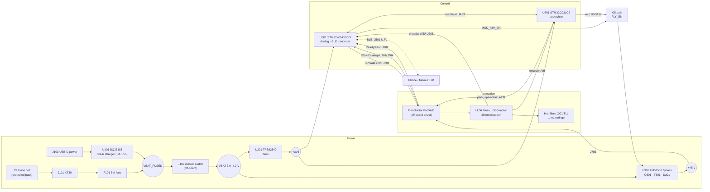
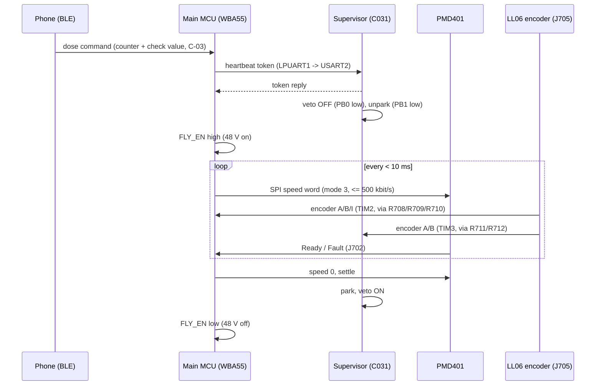

# Piezo Insulin Pump v2: Rev B digital design — engineering project report

| | |
| --- | --- |
| Project | Piezo Insulin Pump v2 (HybridPancreasSim v2), Rev B handover PCB |
| Owner | B Charan |
| Report date | 1 Nov 2026 |
| Design state | Commit `ef091c3` (board/schematic, unchanged since); report revised by the final engineering review of 1 Nov 2026 (`docs/handover/FINAL_ENGINEERING_REVIEW_2026-11-01.md`) |
| Prepared with | Claude Code sessions of 10 Oct, 31 Oct and 1 Nov 2026, from repository evidence only |

> **Safety and scope.** This is a **bench-only prototype** for water or 0.9 % saline. It must **never be connected to a person or an animal**, and real insulin must never be used. It is a **digital handover design**: nothing has been fabricated, built or measured. This report is not a claim that the pump works, is safe for clinical use, or is ready for fabrication. A clean ERC/DRC report does not show that a circuit works.

**Evidence conventions used throughout**

- **Status of design values.** Every value carries the project's status label:
  - DECIDED: owner decision.
  - DS: from a datasheet in `docs/datasheets/`.
  - CALC: calculated.
  - SIM: simulated.
  - ASSUMED: engineering assumption, listed in `docs/handover/ASSUMPTIONS_AND_DEVIATIONS.md`.
  - TBD / PLACEHOLDER: open.
- **Verification sources** are always named:
  - **kicad-cli 10.0.4 in GitHub Actions**: real KiCad results.
  - **pcbcheck.py**: the project's pure-Python approximation.
  - **LTspice / ngspice**: open-loop power-stage simulation only.
- **"Not measured"** means exactly that. No measurement of any kind exists for this project.

**Review status.** This report was audited section by section on 1 Nov 2026. Corrections A1–A12 are listed in `docs/handover/FINAL_ENGINEERING_REVIEW_2026-11-01.md` Part 1 and every recomputed figure is in `validation/logs/report_audit_calcs.txt` (`scripts/audit_calcs.py`). The most important correction: the LM51551 over-voltage trip is **52.8 V typical, 49.9–55.9 V worst case**, not 51.4–54.2 V.

### Evidence level of each part of the design

| Subsystem | Designed | Calculated | Simulated | Verified by KiCad | Hardware tested | Not yet implemented |
| --- | --- | --- | --- | --- | --- | --- |
| Battery path, fuse, switch | ✔ (parts partly TBD) | Current budget | — | ✔ ERC/DRC/parity | ✘ | Fuse part, pack connector, IPC-2152 width check |
| Charger BQ25188 | ✔ | Dissipation | — | ✔ | ✘ | Charge-current setting (firmware); YBG footprint check |
| 3.3 V buck TPS62840 | ✔ | — | — | ✔ | ✘ | — |
| 48 V flyback power stage | ✔ (transformer placeholder) | ✔ | ✔ open loop (LTspice + ngspice) | ✔ | ✘ | Real transformer, loop simulation, flyback loop compaction |
| 48 V over-voltage protection | LM51551 FB-based only | ✔ | — | ✔ | ✘ | **Independent OVP** (proposal §2.3 of the review) |
| 48 V output switch / bleeder | Placeholders only | ✔ (bleeder) | — | ✔ (placeholders) | ✘ | Owner decision (review §2.6) |
| Kill path (enable, veto, park) | ✔ (owner-approved defaults) | ✔ thresholds | — | ✔ | ✘ | SG tests |
| Runaway (speed) protection | Encoder to supervisor only | ✔ budget | — | ✔ | ✘ | **SPI gate + supervisor firmware** (review §2.4) |
| STM32WBA55 logic/pin map | ✔ (CubeMX-verified) | — | — | ✔ | ✘ | — |
| STM32WBA55 power / clock / RF | Placeholders | — | — | ERC errors kept visible | ✘ | **ST documents needed** (review §2.1) |
| STM32C031 supervisor | ✔ | — | — | ✔ | ✘ | Decoupling values (ST DS) |
| PMD401 / encoder / RS-485 interfaces | ✔ (TVS parts TBD) | — | — | ✔ | ✘ | TVS selection, IF-02 level check |
| PCB layout | 4 layers, 80 % of multi-pad nets complete | — | — | ✔ 0 copper errors, 24 unconnected | ✘ | 24 items (review Part 3), human review |
| Firmware | Requirements only | — | (PC simulator outside repo) | n/a | ✘ | All |

---

## Contents

1. Executive summary
2. Problem statement and objectives
3. System architecture
4. Operating principle: piezo motor and syringe
5. STM32WBA55 and STM32C031 architecture
6. Motor driver and piezoelectric drive
7. Battery and charging subsystem
8. 3.3 V regulation
9. 48 V flyback converter: design and calculations
10. Circuit-level design explanations
11. Component selection and BOM
12. PCB stack-up, placement and routing
13. Firmware and communication architecture
14. Safety architecture and fail-safe operation
15. Engineering calculations and simulations
16. ERC/DRC and design-verification evidence
17. Risk assessment
18. Unresolved engineering decisions
19. Limitations
20. Future development and test plan
21. Conclusion
- Appendix A: file index · Appendix B: how to reproduce every result · Appendix C: sources

---

## 1. Executive summary

The project builds a small, close-to-industry-grade insulin-pump **prototype** that doses water or saline correctly on the bench (U-4, D-02). Hardware:

- **Actuation:** a PiezoMotor **Piezo LEGS LL06** linear motor, driven by a **PMD401** driver, pushes the plunger of a **Hamilton 1001 TLL** 1 mL glass syringe directly, with no gears and no screw.
- **Control:** an **STM32WBA55CG** (BLE) runs dosing; a dissimilar **STM32C031C6** supervisor can only stop it.
- **Power:** everything runs from one Li-ion cell.
- **Novelty:** sensorless occlusion detection from step length against encoder travel (K-13).

**What exists (verified from the repository):**

| Item | State |
| --- | --- |
| Schematic | 8 hierarchical sheets, 147 symbols, generated from `scripts/design.py`; every part carries a status field and a source note |
| PCB | 4 layers, 110 × 85 mm, 147 footprints, 492 pads, 93 multi-pad nets; 1104 track segments (F.Cu 1947 mm, B.Cu 1008 mm) and 240 vias |
| **KiCad verification (real)** | kicad-cli **10.0.4** in GitHub Actions on commit `ef091c3`: **ERC** 6 intentional errors + 1 cosmetic warning (unchanged since 10 Oct); **DRC 0 copper errors, 0 schematic-parity issues, 24 unconnected items**, 122 silkscreen warnings |
| Power-stage simulation | 48 V flyback open-loop power stage simulated in LTspice (10 Oct) and **reproduced independently in ngspice (1 Nov)**: averages, peaks and stresses agree within about 2 %, output ripple within ±17 %. At 3.0 V in / 100 mA out (ngspice): 48.8 V, 3.45 A primary peak, 18.7 V on the 25 V FET, 89 V on the 200 V rectifier |
| Routing progress | 35 → 24 unconnected items over 31 Oct–1 Nov. The 24 remaining: **12** need ST documents (STM32WBA55 supply/clock/RF), **1** is an undesigned DNP switch, **11** sit in the STM32WBA55 fan-out or at the BQ25188 package whose footprint is unverified |

**What does not exist:**

- Any hardware.
- Any measurement.
- A real flyback transformer.
- The STM32WBA55 power and RF circuit from ST's documents.
- A control-loop simulation.
- Firmware in this repository.

Five critical safety and design questions need owner decisions (section 18):

- the transformer;
- 48 V over-voltage protection independent of the feedback divider;
- an independent motor-speed stop fast enough for S-06;
- the J703 connector's voltage rating (distributors list 50 V, below the 50.4 V normal maximum and the up-to-55.9 V OVP ceiling);
- the ST documents.

**Completion assessment (§21):** the digital design is a credible, well-documented **pre-release draft**. It is **not** fabrication-ready.

---

## 2. Problem statement and objectives

**Problem.** The owner's earlier v1 work was a C++ closed-loop glucose simulator (HybridPancreasSim) plus an ESP32 + NEMA 17 + leadscrew syringe demo. v2 must be smaller, all-STM32, closer to industry grade, and novel. It must also be honest about what is proven (U-1 to U-14).

**Objectives**

| Objective | Requirement IDs | Status |
| --- | --- | --- |
| Dose water/saline correctly on the bench; success = gravimetric accuracy (±5 %) | U-4, D-11, D-12 | DECIDED; not yet testable (no hardware) |
| Piezo motor pushing a positive-displacement syringe directly | U-8, D-01, K-2, K-3 | DECIDED, designed in |
| All on STM32, BLE on the main MCU | U-2, U-11, K-6, K-17 | DECIDED, designed in |
| Fail-safe: every single fault ends in "48 V off, motor parked" | S-01 to S-04 | Partly designed in (§14) |
| Single 1S Li-ion cell, charger only for charging | E-01, E-09 | Designed in |
| Rev A bench build first, then a Rev B PCB | U-6, K-7 | **Changed 10 Oct**: the owner asked for a digital Rev B handover design now; fabrication still gated on Rev A results (DV-1) |
| Novelty: sensorless occlusion detection; fault-injection hardening (stretch) | U-9, K-13 | Firmware topics; not in this repository |

**Hard limits:**

- Lab prototype only: water/saline, bench, 18–28 °C, never on a person or animal (D-02, K-1).
- Every limit is an engineering target, not a clinical claim.

---

## 3. System architecture

### 3.1 Block diagram



### 3.2 Hierarchical schematic

The schematic is generated from `scripts/design.py` (`docs/handover/pump_v2_schematic.pdf`). Sheet images are in `docs/report/figures/`.

| Sheet | Content | Figure |
| --- | --- | --- |
| Root | Sheet symbols | `figures/sch1_root.png` |
| Power input & charger | J101, F101, J102, BQ25188, USB-C, VBAT divider | `figures/sch2_power_input_charger.png` |
| 3V3 buck | TPS62840 | `figures/sch3_3v3_buck.png` |
| 48V flyback | LM51551, Q301, T301, D301, clamp, snubber, output | `figures/sch4_48v_flyback.png` |
| Kill path | FLY_EN network, supervisor veto, park driver | `figures/sch5_kill_path.png` |
| Main MCU | STM32WBA55CG, SWD, console, RF placeholders, crystals | `figures/sch6_main_mcu.png` |
| Supervisor | STM32C031C6, SWD, LED | `figures/sch7_supervisor.png` |
| PMD401 & encoder | J701–J705, TVS, series resistors, MAX3485 | `figures/sch8_pmd401_encoder.png` |


*Figure 3-1. 48 V flyback sheet. The other sheets are in `figures/`.*

### 3.3 Interface list

| Interface | Connector | Signals | Notes |
| --- | --- | --- | --- |
| Battery | J101 XT30PW-M | VBAT_RAW, GND | Rev B connector OPEN (B.20) |
| Master switch | J102 5.08 mm terminal | VBAT_FUSED → VBAT | Off-board toggle ≥ 5 A |
| Charger input | J103 USB-C (power only) | VBUS, CC1/CC2 (5.1 kΩ Rd) | |
| PMD401 servo | J701 | SPI MOSI/SCLK/SS, AEN, 5 V out | Mode 3, ≤ 500 kbit/s (PMD401 manual) |
| PMD401 status | J702 | Ready, Fault, 5 V | |
| PMD401 48 V | J703 JST SM02B-SRSS-TB | +48V_MOT, GND | **Rating question, §17/§18** |
| RS-485 | J704 | A, B, GND | MAX3485 U701; R714 120 Ω DNP termination |
| LL06 encoder | J705 | I, GND, ENC_VCC, B, A, shield | ENC_VCC from 3V3 by default (JP701) |
| BLE RF | J501 U.FL | RF_ANT | Pi-match placeholder |
| SWD | J502 (main), J601 (supervisor) | 10-pin Cortex debug | |
| Console | J503 4-pin header | GND, CON_MAIN_TX, CON_SUP_TX, CON_SUP_RX | Moved between the MCUs on 31 Oct |

---

## 4. Operating principle: piezo motor and syringe

**Piezo LEGS LL06** (PiezoMotor; item LL06A0-101M1G1E2) [REPO, PMD401 manual DS]:

| Property | Value |
| --- | --- |
| Drive | Piezoelectric legs driven by four phase waveforms of 0–48 V |
| Step size | One full waveform cycle ("wfm-step", 8192 microsteps) gives **about 5 µm** of rod movement with no load; the step shrinks as load rises |
| Waveform | Update rate 65 kHz; maximum cycle rate 1500 Hz |
| Holding | Self-locking when unpowered (holding force > 6.5 N), so **"off" is the safe state** (S-01) |
| Force | 6.5 N stall; 0–3 N recommended working load |
| Speed | Top speed ≤ 15 mm/s (project record, `COMPONENTS_AND_BOM.md`); the PMD401's 1500 Hz × about 5 µm limits it to about 7.5 mm/s [DS]; power about 5 mW per Hz of step rate |
| Encoder | Integrated, 80 nm per count, quadrature A/B at 3.3–5 V |

**Syringe and dose arithmetic** (Hamilton 81320, 4.61 mm bore; DESIGN_REQUIREMENTS §2) [CALC]:

| Quantity | Value |
| --- | --- |
| Plunger area | π × (4.61/2)² = **16.69 mm²** |
| Volume per µm of travel | 16.69 nL |
| 1 U (10 µL, U-100) | 599 µm = **7489 counts** |
| Smallest dose 0.05 U | 30 µm = 375 counts |
| One count | 1.34 nL = 0.00013 U |
| Full syringe 1 mL | 60 mm = 750 000 counts (32-bit position) |
| Speed cap 15 steps/s × ≈ 4.5 µm | ≈ 67.5 µm/s ≈ 0.11 U/s |
| Line pressure 1 bar | 1.67 N on the plunger (3.9 bar would stall the motor at 6.5 N) |

**Sensorless occlusion detection (the novelty, K-13).** Step length falls as load rises, so commanded waveform steps compared with encoder travel give an estimate of back-pressure without a pressure sensor. This is the project's central technical bet and **has not been demonstrated on hardware** (OPEN_QUESTIONS §D).

---

## 5. STM32WBA55 and STM32C031 architecture

| | Main MCU U501 | Supervisor U601 |
| --- | --- | --- |
| Part | STM32WBA55CG (UFQFPN48 assumed, A-1) | STM32C031C6 (LQFP48 assumed, A-2) |
| Core / role | Cortex-M33, TrustZone, 1 MB flash, BLE radio: dosing, encoder counting (TIM2), PMD401 SPI and RS-485, BLE, charger I²C, VBAT ADC | Cortex-M0+ 48 MHz: heartbeat check, own encoder count (TIM3), 48 V veto, park line |
| Independence | Separate code base (F-09) | Dissimilar MCU so one fault cannot defeat both (22 Sep decision) |
| Pin map | 41 functions, verified against the STM32CubeMX 6.18.1 database (0 failures, `validation/logs/pinmap_check.md`) | Same check |
| Open | Supply/RF pins wait for ST documents (U-05); 5 V tolerance, ADC leakage, TIM2 width (U-10, U-11) | Decoupling, boot straps (A-7) |

**Main MCU pin functions** (from `docs/handover/HANDOVER_GUIDE.md` §4, CubeMX-verified):

- **PMD401 SPI3:** SCK PA0, MOSI PB8, NSS PA5.
- **Encoder (TIM2):** CH1 PB6, CH2 PA8, index PB14.
- **RS-485 (USART2):** TX PB0, RX PA11, DE PB1.
- **Heartbeat (LPUART1):** TX PB5, RX PA1.
- **Console:** USART1 TX PB12.
- **Charger I²C3:** SCL PA6, SDA PA7.
- **Control and status:**
  - 48 V enable: PB7.
  - PMD401 status: Ready PB15, Fault PB4.
  - Flyback power good: PA12.
  - Charger interrupt: PA2.
- **Analog:** VBAT sense PB9 (ADC4_IN10).
- **Other:** LED PB2; SWD PA13/PA14/PB3; BOOT0 PH3; RF on the RF pin; HSE 32 MHz; LSE 32.768 kHz.

**Supervisor pin functions:**

- **Veto:** PB0 drives the BSS138 gate. High or high-Z means veto (via R403 pull-up).
- **Park:** PB1 drives the AEN open-drain gate. High or high-Z means parked (via R405).
- **Encoder (TIM3):** CH1 PA6, CH2 PA7.
- **Heartbeat (USART2):** TX PA2, RX PA3.
- **Console:** PA9/PA10.
- **Other:** LED PB2; SWD PA13/PA14; NRST PF2.

**Status of the STM32WBA55 power and RF circuit** (U-05; see `docs/handover/ENGINEERING_BLOCKER_REVIEW_2026-11-01.md` §1):

- The SMPS inductor, VDD11, VDDHPA, VDDANA, VDDRF and VDDRFPA connections, the HSE/LSE load capacitors and the RF pi-match are **placeholders**. They cause the 6 intentional ERC errors and 12 unconnected items.
- ST's AN5948 (RF hardware) and AN6373 (SMPS) have been identified but not read. st.com is outside the session network policy. No value has been taken from memory or from another STM32 family.

---

## 6. Motor driver and piezoelectric drive

The **PMD401** is used as bought (K-4); designing a custom piezo driver is prohibited (HARDWARE_CONSTRAINTS §1.2, 8). Facts from manual 150025-01 [DS]:

| Property | Value |
| --- | --- |
| Supply | 48 V DC ±5 % (45.6–50.4 V), "minimum 5 W" supply |
| Current | About 6 mA stopped; at most 100 mA at full speed |
| Board size | 59 × 39 mm |
| Servo mode (Y13 = 3) | The host sends a **16-bit signed speed** over SPI (≤ 500 kbit/s per the manual; the web page says more, conflict CF-16). The PMD401 **stops the motor if no SPI data arrives for about 10 ms** |
| Park | AEN low powers down (parks) the motor in about 250 ms; at least 80 ms to power up. AEN has a 22 kΩ pull-up and 10 nF to GND |
| Status outputs | Ready (low = ready) and Fault |
| Sensor connector | 5V Out, at most 0.2 A |
| Setup | RS-485 (servo mode with `X0Y13,3`, then `X0Y32` to save) |
| Signal protection | Signals have no EMC protection; the manual asks for series resistors and TVS diodes, which the design has (D701–D709, 100 Ω, E-07). The TVS parts are TBD (U-15) |

**Board-side drive design**

- **Main MCU path:** sets the speed by SPI, closes the position loop on its own encoder count, reads Ready/Fault, and uses RS-485 only for setup.
- **Supervisor path:** owns the park line through Q402 (open drain; parked by default) and the 48 V veto (§14).

---

## 7. Battery and charging subsystem

| Part | Value / status | Evidence |
| --- | --- | --- |
| Cell | Molicel INR18650-P28A on Rev A (K-9); Rev B cell OPEN (B.20) | Distributor data: 2800 mAh typical, 4.2 V charge, 35 A continuous [WEB-2ND] |
| Protection | 1S protected pack (K-12); 5 A fuse F101 (2920 SMD, part TBD) | E-01 |
| Master switch | Off-board, wired to J102 (5.08 mm terminal) | E-01, A-15 |
| Charger | **BQ25188YBGR**: 1 A linear charger; V<sub>IN</sub> operating 3.6–18 V (electrical table; the feature list says 3.0 V), VBATREG 3.5–4.65 V in 10 mV steps, 5–1000 mA fast charge, 55 mΩ battery FET, selectable thermal regulation T<sub>REG</sub> 60/80/100 °C [DS SLUSFJ3] | K-12 |
| Charger wiring | Charges on VBAT_FUSED (after the fuse, before the switch), so charging works with the switch off. **SYS is unloaded**, so the charger is never the load path (E-09) | A-14 |
| Defaults | VBATREG 4.20 V; ICHG 10 mA; I²C watchdog on (resets registers). **Firmware must set the charge current** | SLUSFJ3 §7.5 |
| TS pin | R101 10 kΩ, as the datasheet specifies when TS is unused (0.38 V vs the 90 mV button threshold) | DS |
| Battery sense | R107/R108 1 MΩ/1 MΩ + C104 100 nF into PB9: 4.2 V → 2.1 V; about 2.1 µA drain; τ = 50 ms | CALC (A-27: ADC leakage unverified) |

**Charge-current recommendation (proposal, owner decision):** about 0.5 A. As a linear charger from 5 V, the BQ25188 would dissipate 2.0 W at 1 A with a 3.0 V cell, in a 1.1 × 1.6 mm WCSP [CALC]. The repository datasheet's thermal table lists only the BQ25185 DLH package, so the YBG junction temperature cannot be computed; T<sub>REG</sub> reduces the charge current automatically if the die reaches the set limit.

---

## 8. 3.3 V regulation

- **U201 TPS62840DLC** buck [DS SLVSEC6D]:
  - 1.8–6.5 V input, up to 750 mA, 60 nA operating quiescent current, 100 % duty mode.
  - VSET resistor R201 = 267 kΩ for 3.3 V.
  - L201 2.2 µH; C201 4.7 µF in; C202 10 µF out.
  - MODE = GND (auto PFM/PWM); EN tied to VIN.
- **Supply source:** taken from VBAT, not from the 48 V chain, so motor current spikes stay off the logic rail (constraint 23).
- **Low-cell behaviour (estimate, not derived from SLVSEC6D dropout data):** below about 3.4 V input the buck enters 100 % mode and +3V3 follows VBAT minus its dropout. E-02 requires ≥ 3.0 V while dosing, and S-13 stops dosing at 3.4 V cell.
- **Open conflict CF-8:** E-02's wording says "LDO", which is the Rev A MCP1700; Rev B uses the decided buck.
- **Planes:** +3V3 is distributed on the In2.Cu plane (3V3_L3 zone) everywhere except the VBAT regions (§12).

---

## 9. 48 V flyback converter: design and calculations

**Why a flyback.** A plain boost from 3.0–4.2 V to 48 V would need about 94 % duty and hits the controller's duty limit (29 Sep decision). A non-isolated flyback with n = 5 runs at D ≈ 0.70–0.77. It also has **no DC path from input to output when disabled**, which matters for the kill path (§14).

### 9.1 Design (FLYBACK_DESIGN.md; values in `scripts/design.py`)

| Quantity | Equation / basis | Result | Status |
| --- | --- | --- | --- |
| Controller | LM51551 (K-12), BIAS = VCC = VBAT (works from 2.97 V) | — | DECIDED / DS |
| Switching frequency | R<sub>T</sub> = 2.21×10¹⁰ / f<sub>SW</sub> − 955 | R301 73.2 kΩ → 298 kHz (±15 %) | CALC |
| Turns ratio | V<sub>out</sub> + V<sub>F</sub> = n·V<sub>in</sub>·D/(1−D) | n = 5 → D = 0.765 at 3.0 V, 0.70 at 4.2 V | CALC |
| Primary inductance | ΔI = 40 % of I<sub>pri,avg</sub> | L<sub>p</sub> = 7.3 µH (5–10 µH) | CALC |
| Peak primary | | 3.1 A (calc); 3.39 / 3.45 A (LTspice / ngspice) | CALC / SIM |
| Sense resistor | I<sub>lim</sub> = V<sub>CLTH</sub>/R<sub>s</sub>, V<sub>CLTH</sub> = 93–107 mV [DS] | R305 22 mΩ → 4.2–4.9 A | CALC |
| Soft start | t<sub>SS</sub> = C<sub>SS</sub>·V<sub>REF</sub>/I<sub>SS</sub> | C305 47 nF → 4.7 ms | CALC |
| Output divider | V<sub>out</sub> = V<sub>REF</sub>(1 + 470k/10k), V<sub>REF</sub> 0.99–1.01 V [DS] | 48.0 V nominal; **46.6–49.4 V** with 1 % resistors | CALC |
| Over-voltage | FB > 107/110/113 % of V<sub>REF</sub> [DS] | 52.8 V typical; **49.9–55.9 V worst case** (V<sub>REF</sub> ±1 %, 1 % divider); ≥ 7 % above the regulation point for any one part set; **sensed on FB only** | DS / CALC |
| Output capacitors | ΔV = I·D/(f·C) | 2 × 2.2 µF/100 V X7R + 47 µF/100 V; C702 100 µF/100 V at the connector | CALC / DECIDED |
| FET | CSD16340Q3, 25 V, 6.1 mΩ at V<sub>GS</sub> 2.5 V, Q<sub>g</sub> 6.5 nC [DS] | Gate drive = VBAT | DS |
| Rectifier | PNE20010ER, 200 V / 1 A hyperfast [DS] | 100 V Schottky rejected (§15) | DS |
| Clamp | PMEG10020ELR (100 V/2 A [DS]) + R306 390 Ω 1 W + C308 22 nF | V<sub>DS</sub> 18.5–18.7 V (≈ 75 % of 25 V) | SIM |
| Snubber | R313 220 Ω + C312 100 pF/250 V C0G across D301 | D301 88–97 V (≈ 49 %) | SIM |
| Compensation | Type II, f<sub>c</sub> ≈ 3 kHz < f<sub>RHPZ</sub>/5 (≈ 30 kHz) | R303 3.01 kΩ, C306 180 nF, C307 3.3 nF | CALC, **preliminary** |
| Transformer T301 | n = 5, L<sub>p</sub> 7.3 µH, I<sub>sat</sub> ≥ 5 A, I<sub>rms</sub> ≥ 2.5 A, leakage ≤ 2 %, ≥ 100 V | **No part; placeholder footprint** | PLACEHOLDER |

### 9.2 Remaining work on this stage

1. Select the transformer and fit its footprint.
2. Re-tune the clamp and snubber to the real leakage.
3. Loop simulation (TI LM5155 PSpice model) and a bench Bode measurement.
4. Tolerance stack with 0.1 % divider resistors.
5. Thermal check.
6. Independent over-voltage protection (§14, §18).

---

## 10. Circuit-level design explanations

| Block | Design choice | Reason / source |
| --- | --- | --- |
| Battery path | Fuse after the cell connector, switch after the fuse, charger before the switch | E-01; charging possible with the switch off (A-14) |
| Charger isolation | BQ25188 SYS unloaded; load on VBAT | E-09 "never the load path" |
| VBAT sense | 1 MΩ/1 MΩ + 100 nF reservoir | BQ25188 has no ADC; INA219 dropped (DV-2, DV-13) |
| Logic rail | TPS62840 straight from VBAT | Isolates motor current spikes (constraint 23) |
| 48 V kill path | **FLY_EN = LM51551 UVLO/EN**: 4.7 kΩ pull-down (R401), main MCU via 1 kΩ (R402), supervisor veto Q401 BSS138 | K-10, re-checked against SNVSB75E (EN rising 0.4–0.7 V, UVLO 1.425–1.575 V). MCU high gives 2.72 V → run; pull-down only gives 0 V → off |
| Veto default | R403 10 kΩ **pull-up** on the BSS138 gate: veto ON whenever the supervisor is in reset or not driving PB0 low | Owner decision 10 Oct (closes OPEN item 3 / CF-9); deviation DV-3 |
| Park default | Q402 BSS138 open-drain on AEN with R405 10 kΩ gate pull-up: **parked by default**; the PMD401's 22 kΩ pull-up gives the run level | Owner decision 10 Oct (OPEN item 4); avoids a 3.3/5 V level question |
| PMD401 signals | TVS (D701–D709, parts TBD) + 100 Ω series on every line | E-07, PMD401 manual |
| Encoder fan-out | Encoder A/B through separate 100 Ω resistors to the main MCU TIM2 (R708/R709) **and** the supervisor TIM3 (R711/R712) | S-07, approved 10 Oct (DV-7) |
| Encoder supply | JP701 solder jumper: default +3V3 (bridged 1–2); option PMD401 5 V | OPEN item 12: the PMD401 5 V output dies with the 48 V rail, which could disturb the count |
| RS-485 | MAX3485 at 3.3 V; R714 120 Ω termination DNP, **placed at the connector (1 Nov)** | PMD401 has its own switchable termination |
| Flyback soft-start | C305 next to U301; FLY_SS reaches pin 9 through two vias; AGND pin 7 tied to the exposed pad | SNVSB75E §10.5.1 (31 Oct layout) |

---

## 11. Component selection and BOM

**Status of the 147 schematic symbols** (counted from `hardware/kicad/*.kicad_sch`, 1 Nov):

| Status | Count | Meaning |
| --- | --- | --- |
| DECIDED | 26 | Locked by the owner (K-3 to K-6, K-10, K-12 parts, owner decisions of 10 Oct) |
| DS | 19 | Value or part taken from a datasheet in the repository |
| CALC | 19 | Calculated (flyback, dividers) |
| ASSUMED | 48 | Engineering assumption (A-1 to A-27) |
| TBD | 11 | Part or value open |
| PLACEHOLDER | 24 | Block not designed (T301, 48 V switch, WBA55 supply/RF parts) |
| DNP | 17 | Not fitted (placeholders, options) |

**Key active and power parts**

| Ref | Part | Status | Evidence |
| --- | --- | --- | --- |
| U501 | STM32WBA55CG | DECIDED | CubeMX pin data; datasheet **not in repo** |
| U601 | STM32C031C6 | DECIDED | CubeMX pin data; datasheet **not in repo** |
| U101 | TI BQ25188YBGR | DECIDED | `docs/datasheets/bq25188.pdf` (SLUSFJ3) |
| U201 | TI TPS62840DLCR | DECIDED (variant ASSUMED) | `tps62840.pdf` (SLVSEC6D) |
| U301 | TI LM51551DSSR | DECIDED | `lm51551.pdf` (SNVSB75E) |
| Q301 | TI CSD16340Q3 | DS | `csd16340q3.pdf` |
| D301 | Nexperia PNE20010ER | DS | `PNE20010ER.pdf` |
| D302 | Nexperia PMEG10020ELR | DS | `pmeg10020elr.pdf` |
| Q401, Q402 | BSS138 | DECIDED | `bss138_nexperia.pdf` |
| U701 | MAX3485 | ASSUMED (carried from Rev A, DV-8) | Datasheet not in repo |
| T301 | Flyback transformer | **PLACEHOLDER** | Specification only |

**BOM files.**

- `docs/bom.csv` and `docs/bom_detailed.csv` had been generated on 10 Oct (Stage 2) and were **stale**: 131 references with pre-design-v2 statuses.
- On 1 Nov they were regenerated from the current schematic by `kicad-cli sch export bom` (kicad-cli 10.0.4, GitHub Actions [run 3](https://github.com/BigBiglinn/INSULIN_PUMP/actions/runs/41267788329), arguments identical to `scripts/run_checks.sh`).
- Result: **133 BOM references in 79 grouped lines**; test points, mounting holes and flags are excluded from the BOM.
  - Statuses: DECIDED 26, DS 19, CALC 19, ASSUMED 34, TBD 11, PLACEHOLDER 24.
  - 17 DNP.
- No Rev B supplier, price or stock data exists (COMPONENTS_AND_BOM §7.3).

---

## 12. PCB stack-up, placement and routing

### 12.1 Stack-up and rules (`pump_v2.kicad_pro`, `gen_pcb.py`)

| Layer | Use |
| --- | --- |
| L1 F.Cu | Components, signals, GND pour |
| L2 In1.Cu | **Solid GND plane** (P-02) |
| L3 In2.Cu | Split: **VBAT** under the battery strip (x < 116 mm), along a bottom band and under the 48 V block (x > 155, y > 140.5 mm); **+3V3** everywhere else |
| L4 B.Cu | Signals, GND pour |

**Net classes:**

| Class | Clearance | Track | Via |
| --- | --- | --- | --- |
| Default | 0.15 mm | 0.2 mm | 0.6/0.3 mm |
| PWR | 0.2 mm | 0.8 mm | 0.7/0.35 mm |
| **HV48** (+48V_RAW, +48V_MOT, FLY_SEC) | **0.6 mm on all layers** | 0.4 mm | 0.6/0.3 mm |
| RF | 0.2 mm | 0.3 mm | 0.6/0.3 mm |

**Board rules (generic):**

- Minimum track 0.15 mm; minimum via 0.5/0.3 mm.
- Copper-to-edge 0.3 mm.
- Two scoped DRU exceptions:
  - J703 pad-to-pad 0.35 mm (vendor connector pitch);
  - Q301 pad-to-pad 0.127 mm (NexFET pad pitch). The audit compared the footprint with TI SLPS247E §7.2: it matches within 5 µm, but TI's pads sit at a uniform 0.65 mm pitch (0.15 mm gaps), so moving the four pads to TI's exact positions would remove this exception (proposal, owner approval).
- The fab and its rule file are not chosen (U-16). The stack-up is KiCad's default 1.6 mm, so the RF trace is not impedance-controlled (U-20).

### 12.2 Placement

Functional zones:

| Zone | Location |
| --- | --- |
| Power input and charger | Left edge |
| MCUs | Centre |
| PMD401 and encoder connectors | Right edge |
| 48 V flyback block | Bottom right |
| U.FL connector | Top edge |

Layout changes made on 31 Oct and 1 Nov:
- **31 Oct:** C305, TP302 and J503 moved.
- **1 Nov:** R714 moved.

These positions are also recorded in `gen_pcb.py` `ANCHORS`.


*Figure 12-1. Whole board, current state (drawn by `scripts/pcbplot.py` from the board file; not a KiCad render). The 10 Oct KiCad renders are in `docs/handover/images/`.*

### 12.3 Routing history

| Date | Method | Unconnected | Evidence |
| --- | --- | --- | --- |
| 10 Oct | Freerouting 2.1.0 (3 passes) + DRC-gated hand router | 63 → 35 | kicad-cli 10.0.3 (`validation/drc/baseline_2026-10-10/`) |
| 31 Oct | `layout_fixes.py`: +48V_MOT, FLY_SS, TP302, J503 console, ENC_A_S, stub clean-up | 35 → 28 | kicad-cli 10.0.4 CI run 1 on `ab69cdf`: 28, 0 copper errors, **3 dangling tracks missed by the Python checker** |
| 1 Nov | `layout_fixes_2.py`: ENC_VCC, ENC_I, RS-485 termination, +3V3 at R302.2, remaining stubs | 28 → **24** | kicad-cli 10.0.4 CI run 2 on `ef091c3`: 24, 0 copper errors, 0 dangling |


*Figure 12-2. U301 area after the 31 Oct soft-start rework.*


*Figure 12-3. +48V_MOT route to J703.*

**The 24 remaining unconnected items** (kicad-cli, `validation/drc/pump_v2-drc.rpt`):

| Group | Count | Items | Blocker |
| --- | --- | --- | --- |
| A | 12 | HSE_IN ×2, HSE_OUT ×2, LSE_IN ×2, RF_MCU, WBA_VDD11 ×2, WBA_VDDANA, WBA_VDDRF, WBA_VDDRFPA | ST documents (U-05) |
| B | 1 | SW48_GATE | Undesigned 48 V switch (U-06) |
| C | 11 | 3 at the BQ25188 WCSP: VBAT_FUSED, CHG_INT_N, I2C_SDA (U101→R105). 8 in the U501 fan-out: FLY_PGOOD → PA12, MAIN_SWCLK, PMD_MOSI_M, PMD_SCLK_M, PMD_READY_M, ENC_I_M, VBAT_SENSE, I2C_SDA (R105→U501.6) | BQ25188 ball pitch unverified (U-12); U501 fan-out to be redone with the ST-guided layout |

**Classification after the final review** (trial routing on a scratch copy, nothing committed; details in the final review, Part 3):

| Class | Count | Items |
| --- | --- | --- |
| Routable immediately | 2 | ENC_I_M (31.9 mm, 2 vias), VBAT_SENSE (33.4 mm, 4 vias): clean trial routes, deferred because they cross the U501 area that the ST re-layout will change |
| Blocked by ST documents | 12 + 6 | Group A; plus I2C_SDA (→ U501.6), PMD_SCLK_M, PMD_MOSI_M, PMD_READY_M, MAIN_SWCLK, FLY_PGOOD, whose U501 pins are boxed in until U501 is re-fanned-out with the ST layout |
| Blocked by the TI YBG drawing | 3 | VBAT_FUSED, CHG_INT_N, I2C_SDA (→ U101.C1) |
| Blocked by an owner decision | 1 | SW48_GATE |

**Not yet done by any step:**

- Flyback loop compaction (FL-1 to FL-4); it depends on T301.
- Impedance-controlled RF.
- IPC-2152 current-width check of the battery path.
- A full human review of autorouted copper.

---

## 13. Firmware and communication architecture

**No firmware is stored in this repository.** The owner writes the firmware personally (K-16). A reference implementation and a staged course exist outside the repository (`pump_config.h`, `pump_port.h`, `dose_ctrl.c`, `load_est.c`, `hardened.h`, `port_stm32wba.c`, `pump_app.c`, `sim_plant.c`, `test_main.c`). As of 29 Sep, the supervisor firmware and the BLE input were still to be written. Everything below is a requirement, not an implementation.

| Area | Requirement |
| --- | --- |
| Structure | Plain C11 behind one hardware boundary `pump_port.h`; the same dosing code runs on the PC simulator and the target (F-01) |
| Dose state machine | IDLE → UNPARK → MOVE → SETTLE → IDLE, FAULT reachable from every state (F-02) |
| Hardening | Complement-stored values, doubled limit checks with random delay, encoded booleans, control-flow counter (F-03); glitch testing is a stretch goal (C-07) |
| Position | 32-bit position; 16-bit timers extended in firmware if needed (FW-08) |
| Limits | 0.05 U minimum, 10 U bolus, 15 U per rolling hour, for every command source (S-05, C-04) |
| Watchdogs | IWDG and brown-out reset on both MCUs (F-07, proposed) |
| Supervisor | Separate code base; heartbeat is a changing token (F-09, proposed) |
| Coding standard | MISRA C:2025 on safety modules (F-04, proposed) |

**Communication links**



**Other communication requirements:**

- **RS-485** is used for PMD401 setup only.
- **BLE security:** LE Secure Connections with passkey or numeric comparison, bonded (C-02, proposed).
- **Debug:** SWD locked on Rev B (C-06, proposed).
- **Link loss and the CGM protocol** are undefined (OPEN item 16).

---

## 14. Safety architecture and fail-safe operation

**Safe state (S-01):** 48 V rail off, motor parked and clamped. The LL06 self-locks when unpowered.

**Fail-safe mechanisms in the hardware design**

| Mechanism | How it works | Default if a controller is dead | Status |
| --- | --- | --- | --- |
| 48 V default-off (S-02, K-10) | FLY_EN pulled to 0 V by R401 4.7 kΩ; the main MCU must drive it through R402 1 kΩ | Main MCU dead or reset → 0 V → LM51551 shut down; a flyback has no DC input→output path | Designed |
| Supervisor veto | Q401 BSS138 shorts FLY_EN; gate pulled **up** by R403 | Supervisor dead or reset → veto ON → 48 V off | Designed (owner decision 10 Oct) |
| Park | Q402 open-drain on AEN, gate pulled up by R405 | Supervisor dead → parked | Designed (owner decision 10 Oct) |
| PMD401 SPI timeout | Motor stops about 10 ms after the last SPI word | Main MCU stops talking → stop | Inherent in the PMD401 |
| Firmware safe-halt | Corruption detection → halt (S-03 path 3) | — | Firmware not in repo |
| Independent travel check | Encoder A/B to the supervisor TIM3 (S-07) | — | Hardware done; firmware not in repo |
| Rail discharge | E-11 < 5 V in 5 s | — | **Bleeder not fitted (U-06)** |
| Over-voltage | LM51551 OVP on FB (52.8 V typ, 49.9–55.9 V worst case) | — | **Single-fault gap: open FB divider (U-23)** |

**Known gaps (critical):**

1. **Speed cap only in main-MCU firmware (S-06).**
   - A runaway at the 15 mm/s top speed delivers S-06's 0.5 U in about **20 ms**.
   - Park (250 ms) is too slow. The 48 V veto is unproven, because the PMD401's behaviour as its supply decays is unknown.
   - A supervisor-controlled SPI gate would use the PMD401's ~10 ms timeout: about 11 ms, ≈ 0.28 U [CALC]. This is proposed in ENGINEERING_BLOCKER_REVIEW §6.
2. **No over-voltage protection independent of R307/R308** (U-23). An open feedback divider runs the converter at current limit with nothing to stop the rail rising past the 100 V capacitor rating.
3. **J703 rating.** Distributors list 50 V for the SH series, below the 50.4 V normal maximum and the up-to-55.9 V OVP ceiling [WEB-2ND].
5. **Resistor working voltage on 48 V nodes.** R307 (470 kΩ, FB divider top) is an 0603 with no MPN and sees about 47 V (up to about 55 V). Its datasheet working voltage must be ≥ 69 V (80 % rule); an R307 open-circuit is exactly the U-23 single fault (U-38).
4. Buzzer and STOP button not on the board (owner decision 10 Oct; S-12 proposed).

---

## 15. Engineering calculations and simulations

### 15.1 Flyback power stage: LTspice (10 Oct) and ngspice (1 Nov)

- **Netlist:** `validation/sim/flyback_openloop.cir`.
- **ngspice translation:** `scripts/sim_flyback_ngspice.py` → `validation/sim/ngspice/`.
- **Model scope:** ideal fixed-duty gate drive (no LM51551 model); the transformer is the specification (k = 0.99, about 2 % leakage); generic FET and diode models approximating the datasheets; 480 Ω load = 100 mA.

| Case (snubber fitted) | Simulator | V<sub>out</sub> avg | V<sub>out</sub> p-p | I<sub>pri</sub> pk | V<sub>DS</sub> max | D301 reverse max | I<sub>in</sub> avg | η | P<sub>clamp</sub> |
| --- | --- | --- | --- | --- | --- | --- | --- | --- | --- |
| 3.0 V in | LTspice | 48.48 V | 0.138 V | 3.39 A | 18.49 V | 88.5 V | 2.03 A | 0.82 | 0.415 W |
| 3.0 V in | ngspice | 48.82 V | 0.162 V | 3.45 A | 18.70 V | 89.0 V | 2.07 A | 0.80 | 0.425 W |
| 4.2 V in | LTspice | 49.93 V | 0.144 V | 2.74 A | 18.51 V | 97.1 V | 1.47 A | 0.85 | 0.352 W |
| 4.2 V in | ngspice | 49.88 V | 0.126 V | 2.72 A | 18.44 V | 97.1 V | 1.46 A | 0.85 | 0.348 W |

**Cases without the snubber:**

- **LTspice** showed D301 ringing to its 200 V breakdown, which is why the snubber was added.
- **ngspice** did not converge to a physical steady state (output power exceeded input power), so those runs are flagged invalid and not used.

**Agreement between the two simulators.** V<sub>out</sub> 0.1–0.7 %, I<sub>pk</sub> 0.7–1.8 %, V<sub>DS</sub> 0.4–1.1 %, D301 stress 0–0.6 %, I<sub>in</sub> 0.7–2 %, P<sub>clamp</sub> 1–2.4 %. **Output ripple differs by −12 to +17 %**, and efficiency by 2 points at 3.0 V.


*Figure 15-1. ngspice waveforms, 3.0 V in, 100 mA, snubber fitted. The primary peak (3.45 A) occurs at switch-on (D301 reverse recovery reflected), not at the end of the ramp (about 3.1 A). The off-state drain plateau is about 12.9 V (V<sub>in</sub> + V<sub>out</sub>/n). D301 sees about 63 V steady-state (V<sub>out</sub> + n·V<sub>in</sub>) with an 89 V spike.*

### 15.2 Other calculations (CALC; inputs from repository documents)

| Calculation | Result |
| --- | --- |
| 48 V setpoint tolerance (V<sub>REF</sub> ±1 %, 1 % resistors) | 46.6–49.4 V vs E-03 45.6–50.4 V |
| OVP window | 52.8 V typical; 49.9–55.9 V worst case (upper end above the PMD401's 50.4 V) |
| Bleeder for E-11 (C<sub>max</sub> ≈ 180.8 µF, +20 % electrolytics assumed) | R ≤ 11.5–12.0 kΩ; with 10 kΩ: 4.4 s from 55.9 V, 4.2 s from 50.4 V, 3.5 s nominal; 0.25–0.31 W while on |
| Runaway budget S-06 (0.5 U = 300 µm) | 20 ms at 15 mm/s; 40 ms at the PMD401's 1500 Hz × 5 µm |
| PMD401 at dosing speed | ≈ 0.29 W idle + 0.075 W motor ≈ 0.37 W at 48 V → ≈ 0.15 A from a 3.0 V cell (PMD401 drive losses unknown) |
| Full-speed input current | 2.0–2.07 A at 3.0 V (sim) = the E-05 2.1 A budget |
| Battery life driver | Idle power dominates: E-10 (3 days on ≈ 10 Wh) needs average idle ≤ ≈ 0.13 W |
| Charger dissipation (linear, 5 V in) | 2.0 W at 1 A / 3.0 V; 1.0 W at 0.5 A / 3.0 V |
| FET voltage margin | 18.7 V / 25 V = 75 % (the 80 % rule is met narrowly) |
| Rectifier margin | 97 V / 200 V = 49 % |

---

## 16. ERC/DRC and design-verification evidence

| Check | Tool | Result | File |
| --- | --- | --- | --- |
| ERC | **kicad-cli 10.0.4** (GitHub Actions run 41267379973) | 6 × `power_pin_not_driven` (intentional, U-05) + 1 × `lib_symbol_mismatch` (U701, cosmetic). No PWR_FLAG added to hide them | `validation/erc/pump_v2-erc.rpt` |
| DRC copper (clearance, shorts, holes, edge, courtyards, dangling, thermals) | **kicad-cli 10.0.4**, `--refill-zones` | **0** | `validation/drc/pump_v2-drc.rpt` |
| Schematic parity | **kicad-cli 10.0.4**, `--schematic-parity` | **0 issues** | CI log |
| Unconnected | **kicad-cli 10.0.4** | **24** (§12.3) | same |
| Silkscreen | **kicad-cli 10.0.4** | 69 overlap, 52 over copper, 1 edge (D704) — cosmetic | same |
| Pin map | STM32CubeMX 6.18.1 database (10 Oct) | 41/41 functions, 0 failures | `validation/logs/pinmap_check.md` |
| Python checker calibration | `scripts/pcbcheck.py` vs kicad-cli | Matched unconnected count and copper errors on 10 Oct, 31 Oct and 1 Nov boards. **Missed 3 dangling track ends on 31 Oct** (test corrected 1 Nov) | `validation/logs/pcbcheck_2026-1*.txt` |
| Power stage | LTspice 26.1.1 + ngspice 42 | §15.1: averages, peaks and stresses within about 2 %; ripple within ±17 %; efficiency 0.82 vs 0.80 | `validation/sim/` |

**Distinctions that matter:**

1. **Software validation is done** for ERC, DRC and parity on the current board, plus open-loop simulation.
2. **Bench validation has not started:** the whole of `requirements/VALIDATION_PLAN.md`, including the PW, SG, MT and DA groups.
3. **Manufacturing acceptance has not started:** no fab, no DFM review, no Gerbers.
4. A clean ERC/DRC report does not show that the circuit works.

---

## 17. Risk assessment

Qualitative; S = severity, L = likelihood before mitigation (H/M/L), for a **bench** prototype.

| ID | Risk | S | L | Mitigation in design | Residual / action |
| --- | --- | --- | --- | --- | --- |
| R1 | Motor runaway with live heartbeat (firmware speed cap only) | H | M | Encoder to supervisor (S-07); veto; park; PMD401 SPI timeout | **Open:** add supervisor SPI gate + rate check (§14) |
| R2 | 48 V overshoot after a single fault (open FB divider) | H | L | LM51551 OVP (FB-dependent) | **Open:** independent comparator + supervisor ADC (U-23) |
| R3 | J703 connector rated 50 V used at 48–54 V | M | M | HV48 clearances elsewhere | **Open:** confirm rating; ≥ 100 V board connector |
| R4 | Transformer unavailable or different from the specification → clamp/snubber/loop retune | M | H | Specification complete; simulation scripts reusable | **Open (U-04)** |
| R5 | STM32WBA55 supply/RF wired wrongly | H | M if guessed | Left as placeholders; ERC errors kept visible | Needs ST documents (U-05) |
| R6 | Battery-path current at full motor speed reaches the 2.1 A budget | M | M | 5 A fuse and protection; sense resistor limit 4.2–4.9 A | Measure MT-07; size the path for current limit |
| R7 | Rail does not discharge (no bleeder) → touch voltage after stop | M | H | — | Fit R312 (§18) |
| R8 | Charger overheating at 1 A from 5 V | M | M | Default ICHG 10 mA until firmware sets it | Choose ≈ 0.5 A after thermal check |
| R9 | Unverified footprints (BQ25188 WCSP pitch, connector orientation) | H | M | Marked UNVERIFIED in the library; CSD16340Q3 checked against TI's pattern on 1 Nov (matches within 5 µm) | BQ25188 YBG drawing needed (not in the repository PDF); connector drawings (U-12, U-17) |
| R15 | 48 V divider resistor (R307, 0603, no MPN) under-rated for ≈ 47–55 V | H | M | — | Choose a part with ≥ 75 V working voltage (U-38) |
| R10 | Autorouted copper not reviewed (flyback loop, long ENC_A_S route near the 48 V divider) | M | M | DRC clean | Human review in pcbnew |
| R11 | Encoder count corruption when 48 V cycles | M | M | Encoder powered from 3V3 by default (JP701) | MT-08 |
| R12 | Sensorless occlusion does not work | M (project goal) | M | — | MT-05 / OC tests |
| R13 | Silkscreen warnings hide real issues | L | M | Reports archived | Clean-up before Gerbers |
| R14 | Python checker gives false confidence | M | L | Now cross-checked by kicad-cli in CI on every board change | Keep the CI workflow |

---

## 18. Unresolved engineering decisions (owner)

Full analysis: `docs/handover/ENGINEERING_BLOCKER_REVIEW_2026-11-01.md`; detailed decision proposals (evidence, calculations, pros and cons, schematic and PCB changes, risks): `docs/handover/FINAL_ENGINEERING_REVIEW_2026-11-01.md` Part 2. Owner decision list: same document, §4.2.

| # | Decision | Recommendation (proposal only) |
| --- | --- | --- |
| 1 | ST documents; SMPS vs LDO; U.FL vs antenna | Supply DS + AN5948 + AN6373 + MB1803 schematic; copy ST's values unchanged |
| 2 | Transformer | Check Coilcraft Hexa-Path 1+5 against §9; otherwise a custom winding |
| 3 | R313 package | ≥ 0.5 W rating (2010/2512) |
| 4 | 48 V output switch / bleeder; E-11 status | Option A: delete the switch placeholders, fit R312 10 kΩ ≥ 0.5 W ≥ 100 V |
| 5 | Independent OVP | Hardware comparator on a separate divider to FLY_EN (trip about 52.5 V, band 51.9–53.1 V with a 0.1 % divider), latched by the supervisor, plus supervisor ADC; R307 and the new divider with ≥ 75 V-rated resistors |
| 6 | Runaway stop | OR gate on PMD_SS with a supervisor-controlled, pulled-up block input (blocked by default) + two-tier TIM3 rate check; ask PiezoMotor about a stored speed limit |
| 7 | J703 | Confirm the JST rating; ≥ 100 V board connector + SH cable to the PMD401 |
| 8 | HV clearance (P-03, CF-6) | Keep 0.6 mm on all layers; confirm against IPC-2221C |
| 9 | Battery, connector, fuse, switch, charge current, E-10 | ≈ 0.5 A charge; size the path for the current limit; measure idle power |
| 10 | Remaining PROPOSED requirements (OPEN item 15) | Accept, change or strike each |
| 11 | Fab and stack-up (U-16, U-20) | Choose before any final routing of RF and fine pitch |

---

## 19. Limitations

- **No hardware, no measurements.** Every power, current, battery-life and timing figure is calculated or simulated.
- **The simulation is open loop.** There is no LM51551 model and no real transformer, and the FET and diode models are generic. LTspice and ngspice agree with each other, which shows the netlist is solved consistently, not that the hardware behaves this way.
- **Primary manufacturer documents could not be opened** for ST, JST, Coilcraft, IPC or Molicel. The session network policy blocked those sites. Web-search findings are labelled secondary and were not applied to the design.
- **KiCad version:** kicad-cli **10.0.4** (CI) was used instead of the 10.0.3 named in CLAUDE.md, because no 10.0.3 image exists. Same 10.0 file format.
- **Layout edits since 31 Oct** were made by script on the S-expression file; KiCad's CI checks confirm them electrically. Stored zone fills in the file are cut-back approximations. KiCad refills them for DRC (`--refill-zones`), but they should be refilled (**B**) in pcbnew before any output.
- **BOM data:** no Rev B sourcing data; many parts TBD.
- **Firmware:** none in this repository.

---

## 20. Future development and test plan

**Digital (before any fabrication)**

1. Close the owner decisions in §18, starting with ST documents, transformer, OVP and the runaway stop.
2. Re-lay the STM32WBA55 area per ST (crystals, SMPS, RF 50 Ω), then route the 12 group-A items and the 11 group-C items (§12.3). SW48_GATE follows decision 4. The kicad-cli CI workflow re-checks every push.
3. Verify every footprint against its drawing (PB-03); choose the fab; import its rules and stack-up.
4. Loop simulation (TI LM5155 PSpice model); tolerance and thermal checks.
5. Human layout review; silkscreen clean-up; Phase 6 outputs only after review.

**Bench (VALIDATION_PLAN.md; Rev A first, then Rev B)**

| Group | Purpose | Key checks |
| --- | --- | --- |
| IN | Incoming inspection | Motor code, kit, cell, polarity |
| PW | Power tree | 3.3 V range, 48 V regulation and load step (45.6–50.4 V), default-off, **discharge < 5 V in 5 s (PW-08)**, idle draw |
| SG | Kill path | Veto, **dead supervisor (SG-03)**, heartbeat loss, park default (SG-05), driver timeout (SG-06), latch |
| IF / MT | Interfaces and motor | PMD401 pull-up voltage before connection (IF-02), SPI scope, encoder integrity, step length vs load (MT-05), **PMD401 current at dosing speed (MT-07)** |
| MF | Fluid path | Friction, alignment, leak, priming, compliance |
| DA | Dose accuracy (acceptance gate) | Gravimetric 1 U, 10 U, 0.05 U, basal, back pressure |
| PB | Rev B board | ERC/DRC with the fab rules, footprints, spacing, bring-up, regression |

---

## 21. Conclusion

**Achieved (digital):**

- A complete hierarchical schematic and a 4-layer PCB with every assumption labelled.
- A power stage dimensioned from datasheets and cross-checked by two simulators.
- Owner-approved fail-safe defaults (veto and park on by default).
- Real KiCad verification in CI: 0 copper errors, 0 parity issues.

The board went from 35 to 24 unconnected items. The remaining items are deliberately held for ST's documents and owner decisions rather than guessed.

**Not achieved:**

- A real transformer.
- The ST-guided STM32WBA55 power and RF circuit.
- Independent over-voltage protection.
- A runaway stop fast enough for S-06.
- A confirmed 48 V connector rating.
- Any hardware evidence.

**Completion assessment:**

| Area | Assessment |
| --- | --- |
| Requirements and documentation | Complete and traceable (requirements, decisions, assumptions, open items, this report) |
| Schematic | Functionally complete except the STM32WBA55 supply/RF circuit, the 48 V output switch decision and the independent OVP |
| PCB | **74 of 93 multi-pad nets (80 %) fully connected** (kicad-cli: 24 unconnected items on 19 nets); flyback copper provisional around a placeholder transformer. **Draft, not release** |
| Verification | Software checks done (ERC/DRC/parity in CI, pin map, open-loop simulation). **Bench and manufacturing validation: 0 %** |
| Fabrication readiness | **Not ready.** All eight critical owner decisions (final review §4.2), the remaining footprint verification (BQ25188 YBG, connectors), the remaining routing, a design review and Rev A bench results are prerequisites |

The design is a sound, honest starting point for the successor engineer. It is not a working insulin pump, and it must never be connected to a person or an animal.

---

## Appendix A. File index

| Path | Content |
| --- | --- |
| `PROJECT_OVERVIEW.md`, `requirements/`, `decisions/DECISION_LOG.md` | Requirements, constraints, BOM history, open questions, validation plan, decisions |
| `docs/handover/` | Handover guide, final handover, assumptions/deviations, unresolved issues, flyback design, blocker reports, layout-fix reports, images, schematic PDF |
| `hardware/kicad/` | KiCad 10 project (`pump_v2.kicad_pro/sch/pcb`, project library, DRU) |
| `scripts/design.py`, `gen_*.py`, `kicadlib.py` | Design source of truth and generators (need KiCad's Python for the PCB) |
| `scripts/pcbcheck.py`, `pcbedit.py`, `pcbroute.py`, `pcbsilk.py`, `pcbplot.py`, `layout_fixes.py`, `layout_fixes_2.py`, `report_unrouted.py` | KiCad-free checker, editor, router and the 31 Oct / 1 Nov layout procedures |
| `scripts/sim_flyback_ngspice.py` | ngspice re-run of the flyback power stage |
| `.github/workflows/kicad-checks.yml` | Read-only kicad-cli ERC/DRC/BOM in GitHub Actions |
| `validation/erc`, `validation/drc` | Current kicad-cli reports (provenance in `validation/KICAD_CI_PROVENANCE.md`); 10 Oct baseline in `baseline_2026-10-10/` |
| `validation/logs`, `validation/sim` | Layout-fix logs, Python checker results, pin-map check, simulations |
| `docs/report/` | This report and its figures |

## Appendix B. How to reproduce every result

```bash
# Python checker / router / simulation (Linux or Windows, Python >= 3.10)
pip install shapely numpy matplotlib
python3 scripts/pcbcheck.py                                  # connectivity, clearance, dangling (approximation)
python3 scripts/report_unrouted.py hardware/kicad/pump_v2.kicad_pcb out.txt
python3 scripts/sim_flyback_ngspice.py                        # needs ngspice on PATH
```

```powershell
# KiCad (Windows, KiCad 10.0.x) - the real checks
cd <repo>
# open hardware/kicad/pump_v2.kicad_pro in pcbnew, press B (refill zones), save
bash scripts/run_checks.sh          # or the kicad-cli commands in CLAUDE.md
```

Or push to the branch: `.github/workflows/kicad-checks.yml` runs kicad-cli 10.0.4 ERC/DRC/BOM on GitHub's runners and prints the reports in the job log.

## Appendix C. Sources

- **Primary, in the repository:**
  - PiezoMotor PMD401 Technical Manual 150025-01.
  - TI SNVSB75E (LM5155/LM51551), SLUSFJ3 (BQ25188), SLVSEC6D (TPS62840), CSD16340Q3.
  - Nexperia PNE20010ER, PMEG10020ELR, BSS138P (`docs/datasheets/`).
- **Secondary, from web search** (see the source list in `docs/handover/ENGINEERING_BLOCKER_REVIEW_2026-11-01.md`):
  - ST AN5948 / AN6373 / STM32WBA5xxx datasheet locations.
  - TI E2E notes on the LM5155 PSpice model.
  - Coilcraft Hexa-Path family.
  - Distributor ratings of the JST SM02B-SRSS-TB.
  - IPC-2221 Table 6-1 summaries.
  - Molicel P28A distributor data.
